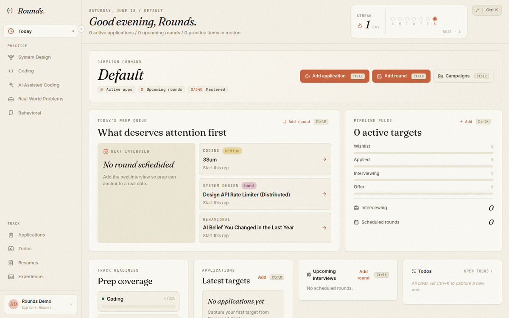
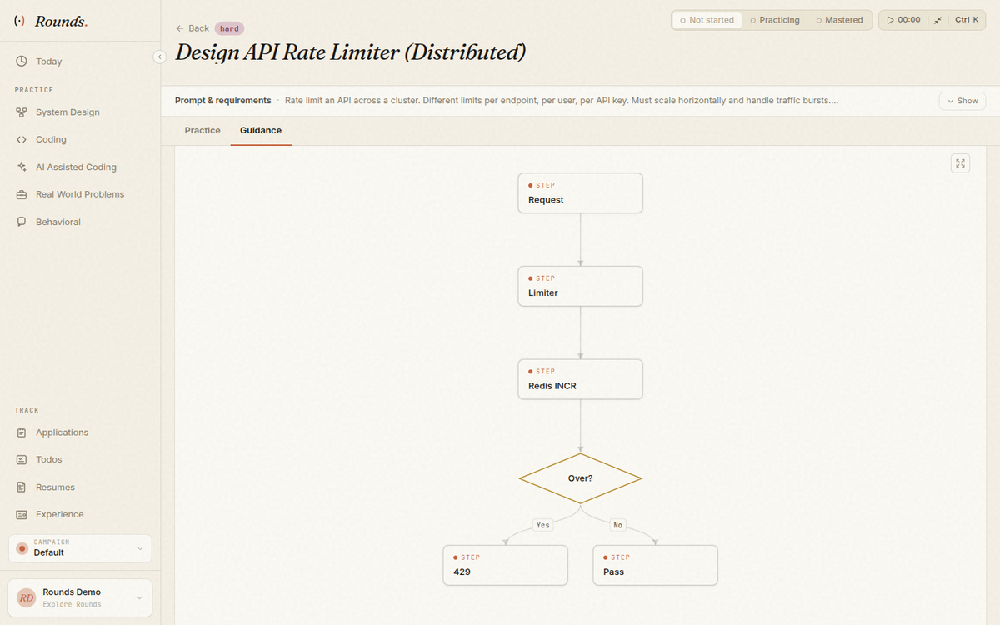
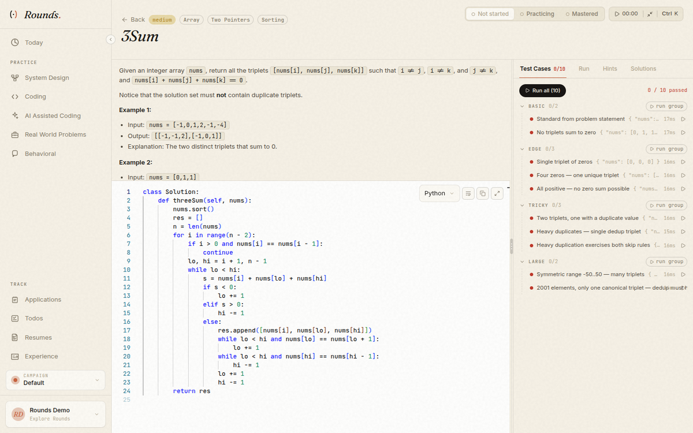

# Rounds: Career Command Center

Rounds is a self-hostable career command center that connects a person's canonical professional history and evidence to the opportunities they pursue, the artifacts they submit, the interviews they prepare for, the practice they complete, and the next actions they should take.



<p align="center">
  
  
</p>

<p align="center"><strong>📸 <a href="SHOWCASE.md">See the full visual showcase »</a></strong> — system design, coding, behavioral, applications, and Resume Studio.</p>

Current release: **v1.0.0**

Hosted demo: **https://rounds.keyurgolani.name**

Demo login on the hosted instance:

- Email: `demo@rounds.keyurgolani.name`
- Password: `RoundsDemo123!`

Visitors share the demo account, and other visitors can see what you add while it lasts, so don't enter real personal details. Any sign-out, the 30-minute idle one included, clears what everyone added.

The demo is off unless the operator sets `ROUNDS_ENABLE_DEMO=true` on PocketBase. Off is the default on every install, self-hosted ones included: PocketBase refuses the demo account's sign-in and gives it a new random password and token key at every start. With the demo on, the account runs under the demo tier's limits, can't change its profile, can't hold share links, AI providers, or AI settings, and can't run code unless the operator also sets `ROUNDS_GATE_DEMO_EXECUTION=enabled` on the runner.

**Upgrading a hosted demo:** set `ROUNDS_ENABLE_DEMO=true` on the PocketBase service before you deploy the release that adds `1700006700_demo_contain.js`, or the demo login stops working. That migration deletes the demo account's share links (and their view records), AI providers, and AI settings.

**Upgrading to the release that adds `1700008500_legacy_share_migration.js`:** every share link made before it stops working when it deploys, for good. Owners make new ones in the share dialog: open Share on the resume, then Get a new link under Older links. Sharing stays closed after the deploy: until you open it, no share link resolves, old or new, and nobody can make one. To open it:

1. Start the snapshot materializer, run and sign its scan, and set `ROUNDS_GATE_LEGACY_SNAPSHOT_CREATE=enabled` on PocketBase and every runner ("Legacy Artifact Snapshots" in [docs/operations.md](docs/operations.md#legacy-artifact-snapshots)).
2. Set `ROUNDS_ADMISSION_SECRET` and `ROUNDS_SHARE_RESOLVER_PASSWORD` on PocketBase and every runner.
3. Set `ROUNDS_GATE_SHARE_CAPABILITY_RESOLUTION=enabled` on every runner and the frontend, together. Empty, or any other value, keeps sharing closed.

Opened without steps 1 and 2, the share dialog says it can't create a new link yet. The dry run and the receipt are in the "Older share links" runbook in [docs/operations.md](docs/operations.md#older-share-links).

**Upgrading to the release that adds `1700008700_attempt_grade_rules.js`:** from this release, every code run, test run, grade, and take-home submission is a job on PocketBase's execution store, and nothing runs code inside a runner request. Before you deploy:

1. Set `ROUNDS_EXECUTION_SECRET` on PocketBase and every runner, the same value on each: 32 to 72 printable characters, such as the output of `openssl rand -hex 32`. Keep `ROUNDS_ADMISSION_SECRET` set on both.
2. Set `ROUNDS_GATE_EXECUTION_DEFINITIONS=enforce` on every runner and the frontend, and restart both.

If a runner lacks any of these, the app says code runs are turned off on this server and keeps every draft, and the runner's start log names each missing setting. If PocketBase lacks the secret or the values differ, code runs say they're unavailable, and the runner logs `login_rejected`. The migration also makes graded attempts the server's to write: no client can create a graded row or change one, and rows already saved stay as they were. "Execution Job Store" in [docs/operations.md](docs/operations.md#execution-job-store) and the sections after it have the checks to run after the deploy.

## Features

- System design practice with question lists, API-backed cheat-sheet guides, diagrams, trade-off panels, and senior follow-up topics.
- Coding practice with Monaco editor, local drafts, focus mode, custom runs, full-suite evaluation, curated runnable question sets, and structured problem metadata.
- AI Assisted Coding rounds with multi-file Monaco workspace, AI chat (Ask mode) using your configured provider, per-checkpoint test runner, and a rubric-grade submission flow.
- Behavioral prep with competency-tagged questions, STAR story guidance, personal anecdotes, and question-to-story linking.
- Application tracking with companies, roles, statuses, rounds, offers, campaign context, and todos.
- Resume Studio with four templates, per-section editors, drag-and-drop reordering, JD-aware tailoring, ATS scoring, version history, AI bullet rewrites, server-rendered PDFs, exports to DOCX / HTML / Markdown / plain text / JSON Resume, and public share links.
- Command center, theme controls, streak tracking, and dashboard widgets for day-to-day prep.

## Stack

| Layer | Tech |
| --- | --- |
| Frontend | React 18, TypeScript, Vite, Tailwind CSS |
| Auth + data | PocketBase + SQLite |
| Code runner | FastAPI + Python/Node subprocess drivers |
| Deployment | Docker Compose or Kubernetes manifests |
| Tests | Vitest + Testing Library, pytest on Python 3.12 |

## Repository Layout

```text
.
├── frontend/              React + Vite SPA, production nginx config
├── backend/               FastAPI code runner + AI/PDF/share routers
├── backend/pdf_renderer/  Node + Puppeteer sidecar for high-fidelity PDFs
├── backend/materializer/  Node service that renders resume snapshots for PocketBase
├── pocketbase/            PocketBase image, migrations, hooks, seeds
├── docs/                  Deployment notes
├── k8s/                   Kustomize manifests
├── docker-compose.yml     Local development stack
└── docker-compose.prod.yml Single-box production stack
```

## Local Development

```sh
cp .env.example .env
docker compose up -d
```

Code runs need two values in `.env`: `ROUNDS_EXECUTION_SECRET`, 32 to 72 printable characters such as the output of `openssl rand -hex 32`, and `ROUNDS_GATE_EXECUTION_DEFINITIONS=enforce`. Set them, then run `docker compose up -d` again. Without them, every code run says it's turned off and keeps your draft.

Services:

- Frontend: `http://localhost:3001`
- PocketBase: `http://localhost:8090`, admin UI at `http://localhost:8090/_/`
- Runner: `http://localhost:3099`

Dev compose bootstraps a PocketBase admin from `PB_ADMIN_EMAIL` and `PB_ADMIN_PASSWORD` when set. The `.env.example` defaults are for local development only.

## Production Compose

```sh
cp .env.example .env
# edit .env for your domain, admin credentials, CORS, OAuth, and signup policy
docker compose -f docker-compose.prod.yml up -d
```

Only the frontend port is exposed. nginx routes runner endpoints to FastAPI and the rest of `/api/*` to PocketBase. It doesn't serve PocketBase's admin UI or admin API; [PocketBase Admin Access](docs/operations.md#pocketbase-admin-access) shows how to reach the admin UI.

Production compose pulls published images from Docker Hub by default:

- `keyurgolani/rounds-frontend`
- `keyurgolani/rounds-pocketbase`
- `keyurgolani/rounds-runner`

PocketBase data lives in the `pb_data` Docker volume. Back it up regularly.

## Signup Policy

Hosted instances can disable public signups:

```env
VITE_DISABLE_SIGNUPS=true
ROUNDS_DISABLE_SIGNUPS=true
```

`VITE_DISABLE_SIGNUPS` hides signup UI in the frontend. `ROUNDS_DISABLE_SIGNUPS` blocks direct PocketBase user creation through a server-side hook.

## Migrations and Seed Data

Fresh deployments run these migrations in order:

1. `1700000000_init_collections.js` creates the final schema.
2. `1700000100_seed_data.js` loads all shared questions, categories, coding question sets, and guide cheat sheets.
3. `1700000500_bootstrap_admin.js` optionally creates the first PocketBase admin from environment variables.
4. `1700000600_demo_user.js` creates the hosted demo user and demo-run limiter fields.
5. `1700000700_resume_studio.js` adds resume, resume version, and bullet-library collections.
6. `1700000800_ai_providers.js` adds the per-user AI provider credential collection (keys stored encrypted at rest).
7. `1700000900_share_links_resume_rel.js` extends `share_links` with a relation to resumes for public read-only views.

`1700006700_demo_contain.js` deletes what accounts with `is_demo` own in `resume_share_links` (with their `resume_share_views`), `ai_settings`, and `ai_providers`. It's forward-only and touches nothing a standard account owns. See the hosted-demo upgrade note above.

`1700008500_legacy_share_migration.js` turns off every share link made before it, for good, records each one's outcome in `legacy_share_migration`, and drops the link fields only those links used. Its `migrate down` keeps every link off. See the upgrade note above.

`1700008700_attempt_grade_rules.js` changes the create and update rules of `ai_coding_attempts` and `take_home_attempts` so that a client writes only its own open rows, never a graded one, and never an `envelope`. It reads and writes no row, keeps a collection's lock if you locked one, and its `migrate down` keeps the new rules. See the upgrade note above.

The release that adds `1700006000_account_scope_rules.js` tightens the create and update rules on every user-owned collection so a write must name the signed-in account, and makes `resume_share_views` superuser-only. Before deploying it, back up `pb_data` and run the cross-owner relation scan on a copy taken with PocketBase stopped. The rules are forward-only: `migrate down` keeps them. See the "Account-scope rules" runbook in [docs/operations.md](docs/operations.md).

## Verification

```sh
npm --prefix frontend test
npm --prefix frontend run build
python3.12 -m venv /tmp/rounds-backend-venv
/tmp/rounds-backend-venv/bin/python -m pip install -r backend/requirements.txt
/tmp/rounds-backend-venv/bin/python -m pytest backend
```

## Environment Variables

See `.env.example` and `frontend/.env.example` for the complete list.

| Variable | Purpose |
| --- | --- |
| `HTTP_PORT` | Production frontend host port |
| `POCKETBASE_PORT` | Dev PocketBase host port |
| `RUNNER_PORT` | Dev runner host port |
| `FRONTEND_PORT` | Dev frontend host port |
| `CORS_ALLOW_ORIGINS` | Runner CORS origins |
| `PB_ADMIN_EMAIL`, `PB_ADMIN_PASSWORD` | PocketBase admin bootstrap; also used by the runner's public-share endpoint to bypass owner rules |
| `PDF_RENDERER_URL` | Internal URL of the headless-Chromium PDF renderer (defaults to the sidecar service) |
| `AI_KEY_SECRET` | Symmetric secret used to encrypt user-supplied AI provider keys at rest |
| `VITE_POCKETBASE_URL` | Browser PocketBase base URL; blank means same-origin |
| `VITE_API_PROXY_TARGET` | Vite dev runner proxy target |
| `VITE_POCKETBASE_PROXY_TARGET` | Vite dev PocketBase proxy target |
| `VITE_DEV_ALLOWED_HOSTS` | Comma-separated Vite dev allowed hosts |
| `VITE_OAUTH_GOOGLE_ENABLED`, `VITE_OAUTH_GITHUB_ENABLED` | Render OAuth buttons |
| `VITE_DISABLE_SIGNUPS`, `ROUNDS_DISABLE_SIGNUPS` | Disable signup UI and server-side user creation |

## License

MIT. See `LICENSE`.
