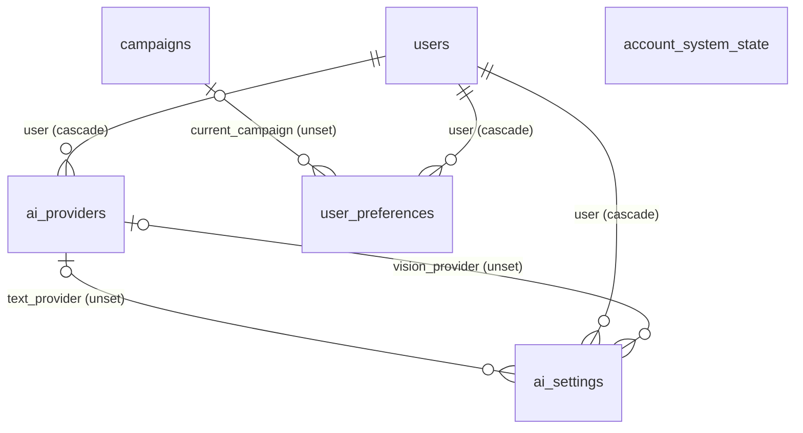
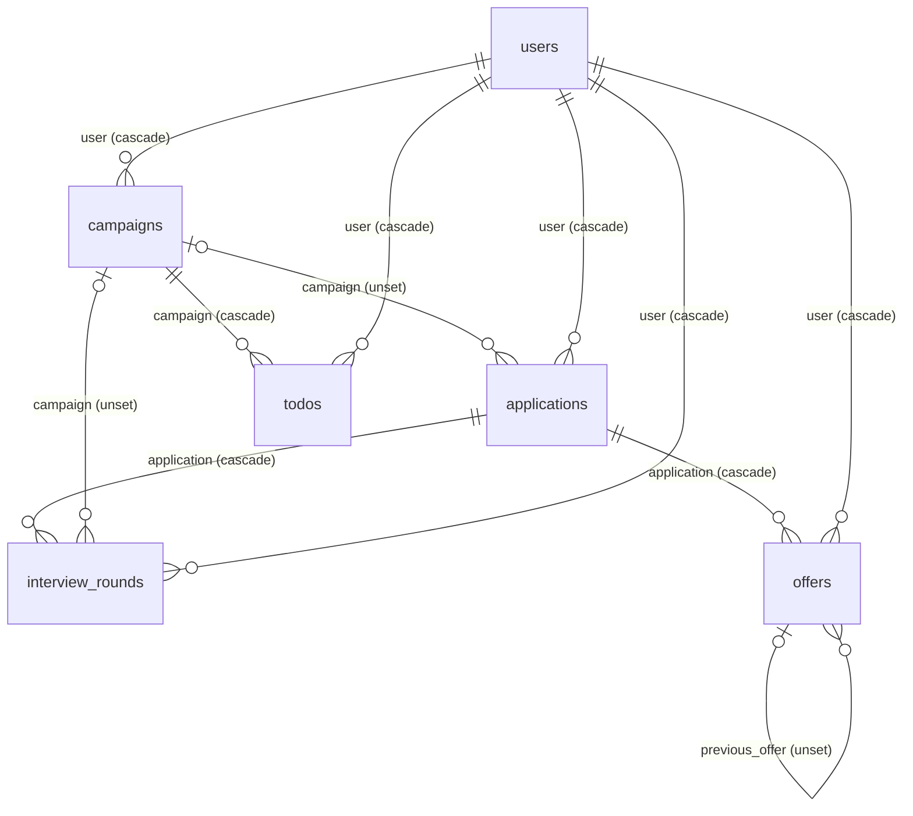
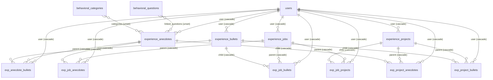
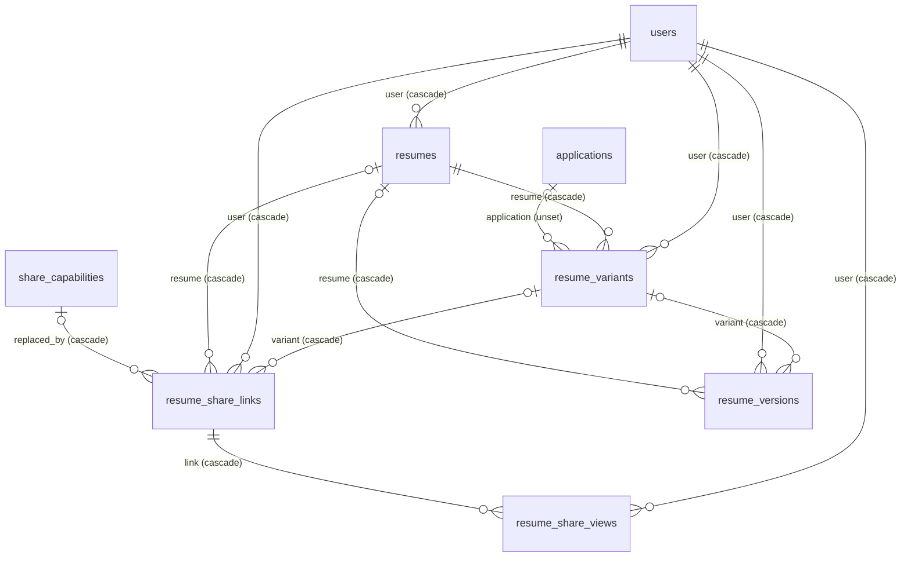
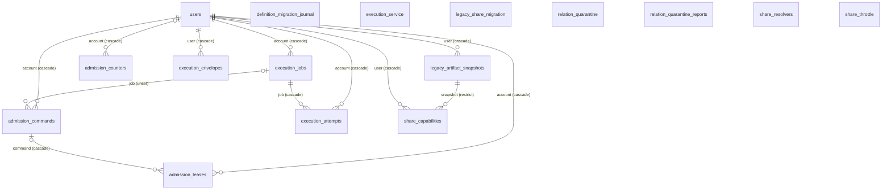
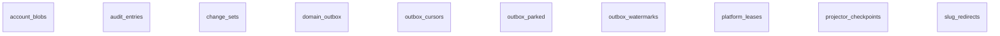
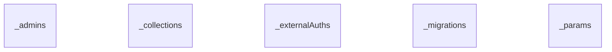

# DR-0004: Canonical database and transaction owner

<!-- Generated from docs/decisions/DR-0004-canonical-database.json, contracts/database/erd.json, and contracts/database/benchmark.json by node scripts/conformance/run.mjs --write. Edit those, not this file. -->

| Record | Status | Owner | Approver | Approval | Leaf |
| --- | --- | --- | --- | --- | --- |
| DR-0004@1 | draft | Domain Platform | pending review | not ratified: not citable | ROUNDS-02-L01 |

Issue #18 (ROUNDS-02-L01). Spec lines cite rounds-review's docs/superpowers/specs/2026-10-18-rounds-review-board-design.md. A citation path@62d4eae:L<a>-L<b> is lines at the audited revision; facts about next were read at 6c4a5a3. Alternative A was the starting point because every store next added since R0 already works that way, and the SQLite benchmark (contracts/database/benchmark.json, synthetic data only) decides whether it holds.

## The ten decisions

| Decision | Concern | Store | Owning process | Owning leaf |
| --- | --- | --- | --- | --- |
| DB1. Canonical write database | canonical-write-database | sqlite-data | PocketBase (the pocketbase container), the only process that opens pb_data | ROUNDS-02-L01 |
| DB2. Transaction owner and isolation | transaction-owner | sqlite-data | the command's gateway hook route, in PocketBase's JSVM | ROUNDS-02-L02 |
| DB3. Gateway placement | gateway-placement | sqlite-data | PocketBase hook routes; the runner is only ever a caller | ROUNDS-02-L02 |
| DB4. Account authorization | account-authorization | sqlite-data | the command's gateway hook route, inside its transaction | ROUNDS-02-L02 |
| DB5. Idempotency store | idempotency-store | sqlite-data | the command's gateway hook route | ROUNDS-02-L03 |
| DB6. Aggregate and version model | aggregate-version-model | sqlite-data | the command's gateway hook route | ROUNDS-02-L03 |
| DB7. Outbox and projectors | outbox-projectors | sqlite-data | the runner's dispatcher, as dispatcher_service | ROUNDS-02-L05 |
| DB8. Backup and restore owner | backup-restore | n/a:a procedure over sqlite-data and files; #157 names the backup target | an operator procedure with a reader process beside PocketBase, owned by #157 | ROUNDS-32-L03 |
| DB9. PocketBase retained, upgraded, or replaced | pocketbase-version | n/a:a binary version, not a store | the pocketbase image build (pocketbase/Dockerfile) | ROUNDS-02-L01 |
| DB10. Byte store | byte-store | files | PocketBase file storage, written by gateway routes | ROUNDS-10-L01 |

### DB1. Canonical write database

Career data has one canonical write database: PocketBase's SQLite file pb_data/data.db, in WAL mode. Canonical records, relations, versions, change sets, audit entries, idempotency results, and the outbox all live in it, so one SQLite transaction covers a command and everything it records. File bytes sit beside it in pb_data/storage (DB10). pb_data/logs.db is PocketBase's request log and never canonical. No other process opens these files while PocketBase runs.

| Concern | Store | Owning process | Owning leaf | Status |
| --- | --- | --- | --- | --- |
| canonical-write-database | sqlite-data | PocketBase (the pocketbase container), the only process that opens pb_data | ROUNDS-02-L01 | draft |

**Alternatives**

- A second database the runner owns (alternative C): No transaction would cover a command's rows and its history; auth, files, and the containment stores stay in PocketBase.
- Postgres through PocketBase: PocketBase runs only on its embedded SQLite (rejected options).

**Failure modes**

- One node: a deploy, restart, or crash makes the product unavailable until PocketBase is back (one replica, Recreate).
- A full disk stops every write, the audit and outbox rows with them.
- A long read transaction, such as a backup's, keeps the WAL from checkpointing, so the WAL grows until it ends.
- The live pragmas are journal_mode=wal and synchronous=1 (1 is NORMAL): a process crash loses no commit, but a power or kernel crash can lose the last commits before a checkpoint.
- PocketBase's memory outgrows the shipped 512Mi limit at 10 accounts (limits), so under that load the kubelet would OOM-kill it until #176 raises the limit.

**Limits**

- One writer: at most 252 commands per second with 10 accounts (249 with 1), on one Go scheduler thread standing in for the 500m CPU limit. More clients only queue longer: at 64 clients a command waited 1.2 s at p99 for the writer.
- The WAL peaked at 391 MiB with 10 accounts and 44 MiB with 1.
- PocketBase's RSS peaked at 682 MiB with 10 accounts and 325 MiB with 1, against the 512Mi limit, with GOMEMLIMIT at 460MiB. GOMEMLIMIT bounds only the Go heap, and PocketBase's SQLite driver allocates outside it, which likely holds the rest. #176 (ROUNDS-34-L07) ships a limit of at least 1Gi.
- It scales up, not out: no second replica and no second writer.

**Consequences.** #19 to #23 and every context build on one SQLite file, and throughput is bounded by one writer, which the receipt measures against the floor's load.

**Migration.** None. The data already lives here.

**Rollback.** Nothing to roll back. A revision that picks another database is a full authority transfer under spec 2699's template, scheduled by #17.

Sources: spec 1942-1951; spec 2069-2071; https://pocketbase.io/faq/; contracts/database/benchmark.json.

### DB2. Transaction owner and isolation

Each command runs in exactly one runInTransaction that its gateway route owns, and commits or rolls back whole. PocketBase queues all writes and explicit transactions through a single db connection (its v0.22.40 notes), so commands run one at a time and see each other as serial. Every read that decides the outcome (the expected versions, the account check, the invariant checks) goes through the transaction's Dao, never $app.dao(), so it sees the command's own writes and nothing that commits after it. No network call runs inside a transaction: provider calls, renders, and relays run outside and come back as new commands. Batch work (backfills, transfers, purges) commits at most 500 rows per transaction, as #14's migration does.

| Concern | Store | Owning process | Owning leaf | Status |
| --- | --- | --- | --- | --- |
| transaction-owner | sqlite-data | the command's gateway hook route, in PocketBase's JSVM | ROUNDS-02-L02 | draft |

**Alternatives**

- Optimistic transactions over several connections: PocketBase 0.22 writes on one connection; there is nothing to run concurrently.
- One REST call per record with compensation: Not atomic: a failure between calls leaves half a command (rejected options).

**Failure modes**

- A slow transaction holds the only writer, and every other command queues behind it; the lock budget bounds it.
- A read through $app.dao() inside the callback sees only committed state, so a check can pass on rows the command already changed; #19 lints for it.
- A network call inside the callback would hold the writer for the call's whole length; #19 refuses it.
- A command that throws after its writes leaves nothing behind (the before-commit failpoint), and its retry with the same command_id commits once.

**Limits**

- Lock budget: at the steady rate with 10 accounts the writer is held 2 ms at p50 and 23 ms at p99 per command, and a command waits 23 ms at p99 for it.
- Batches of at most 500 rows; the transfer's batches of 30 applications held the writer 92 ms at p99.

**Consequences.** #19's API is one function per command that takes the transaction's Dao. Throughput falls as hold time grows, so commands stay small and do their slow work outside.

**Migration.** None now. #19 builds the gateway on it.

**Rollback.** None until #19 ships; after that, a superseding revision.

Sources: spec 1942-1951; https://github.com/pocketbase/pocketbase/blob/master/CHANGELOG_16_22.md (v0.22.40); contracts/database/benchmark.json.

### DB3. Gateway placement

The command gateway is a set of PocketBase hook routes under /api/rounds/commands/, registered as Caller rows in docs/security/server-writes.md. The SPA reaches them through nginx's existing /api/ pass-through, under its 1m body cap; no port, hostname, or route outside /api/ is added. The runner reaches PocketBase only through hook routes, never a collection write. On next it still makes 9 direct collection writes, all with the caller's token: the 7 provider and settings writes in backend/routers/ai.py move behind #73's routes, and the 2 in backend/routers/take_home.py end with #3's PR 4, which makes graded rows server-only. Its share and execution calls already use hook routes. PocketBase 0.22 loads *.pb.js only from the top of pb_hooks (checked on the native binary: a nested file never ran), so each package registers its routes in one top-level <package-id>.pb.js and keeps its code at its DR-0002@2 target path.

| Concern | Store | Owning process | Owning leaf | Status |
| --- | --- | --- | --- | --- |
| gateway-placement | sqlite-data | PocketBase hook routes; the runner is only ever a caller | ROUNDS-02-L02 | draft |

**Alternatives**

- Routes in the runner that call PocketBase's REST API: Not atomic, and a second authorization point (rejected options).
- Runner-fronted gateway routes (alternative D): An extra hop and process per command with no gain for commands that need no runner work.

**Failure modes**

- A route that doesn't register as a Caller row is an unrecorded writer; #19's registry check fails it.
- A gateway-owned collection that keeps a REST write rule is a path around the gateway; DB4 nulls it at each transfer.
- Until #73 and #3's PR 4 land, the runner's 9 writes keep going around the gateway with the caller's token.

**Limits**

- A command body up to nginx's 1m default under /api/.
- Handlers run on PocketBase's pool of JS VMs, and a handler's CPU time inside the transaction adds to the lock hold.

**Consequences.** #19 builds routes, not a service. Each later context adds its commands as hook routes in its package directory.

**Migration.** None. No route exists yet.

**Rollback.** Before #19 ships, none. After, moving the gateway is a superseding revision and a route-by-route transfer.

Sources: spec 1206-1210; spec 1942-1951; frontend/nginx.conf; docs/security/server-writes.md; backend/routers/ai.py; backend/routers/take_home.py.

### DB4. Account authorization

The account is the bearer's auth record, which the route reads inside its transaction; no command body names its account. Each record a command loads and each relation endpoint it writes is checked against that account in the same transaction with #10's predicate (pocketbase/pb_hooks/relation_endpoints.js), and #10's triggers stay as the backstop. Share capabilities keep #11's and #12's checks. #9's collection rules (docs/security/account-scope.v1.json) keep guarding legacy REST writes until each context transfers; the transfer leaf then sets that context's create, update, and delete rules to null, and #21's tables are born with null rules. #1's three writer kinds (Caller, Service, System) are ratified as they stand. Service identities are non-superuser auth collections whose login answers only under the collection's exact name: execution_service and share_resolvers today, ai_gateway (#73) and dispatcher_service (#22) planned. The gateway never authenticates as the superuser.

| Concern | Store | Owning process | Owning leaf | Status |
| --- | --- | --- | --- | --- |
| account-authorization | sqlite-data | the command's gateway hook route, inside its transaction | ROUNDS-02-L02 | draft |

**Alternatives**

- Keep #9's collection rules as the only check: Hook routes write through the Dao, which skips collection rules (account-scope's superuser_bypass entry).
- Authorize in the runner before calling PocketBase: The check would sit outside the transaction it protects, and a second process would hold the decision.

**Failure modes**

- A route that loads a record without the account check would cross accounts; the bench answers another account's id and a missing id with the same 404, and #19 keeps that.
- A REST write rule left open on a transferred collection is a second writer; #19's bypass guard checks every gateway-owned collection.
- Because Dao writes skip collection rules, the route's own check is the only one on its writes.

**Limits**

- One account per command; no command spans accounts.

**Consequences.** Authorization lives in one place per command, inside the transaction. #172 registers each route's rule in its matrix.

**Migration.** None now. Each transfer leaf nulls its context's REST write rules in its own migration.

**Rollback.** A transfer's rule change rolls back with that transfer, before its point of no return.

Sources: spec 1942-1951; docs/security/server-writes.md; docs/security/account-scope.v1.json; pocketbase/pb_hooks/relation_endpoints.js.

### DB5. Idempotency store

Command idempotency uses #1's admission_commands, keyed by its unique (account, command_id) index, with the v7 id check it already enforces. #20 adds domain-command rows kept 30 days; they cascade with the account, and the 30-day expiry bounds that cascade. A replay with the same fingerprint returns the stored result and writes nothing, and a changed body under the same id is a conflict. #22's due-work removes expired rows, and #20 owns the behavior.

| Concern | Store | Owning process | Owning leaf | Status |
| --- | --- | --- | --- | --- |
| idempotency-store | sqlite-data | the command's gateway hook route | ROUNDS-02-L03 | draft |

**Alternatives**

- A new idempotency table for domain commands: Two stores for one key; admission_commands already has the key, the v7 check, and the cascade.
- No stored result, only a dedupe key: A retry couldn't return the original result, so clients couldn't tell a replay from a conflict.

**Failure modes**

- A retry after 30 days is a new command; the window is the contract.
- Deleting an account cascades its window of rows in one transaction, about 10,000 at the floor (the bench's idempotency seed).

**Limits**

- 30 days of rows per account; the receipt's seed holds 10,000 per account, and the replay share of the mix writes nothing.

**Consequences.** #20 extends a live table instead of adding one, and #19's replay path reads it inside the command's transaction.

**Migration.** #20 adds its columns and the domain row kind in an additive migration.

**Rollback.** #20's migration has a down step; admission rows are untouched.

Sources: docs/security/server-writes.md; pocketbase/pb_hooks/admission.js.

### DB6. Aggregate and version model

Every aggregate row carries an integer version that each committed change raises by one. A command sends the versions it read as a vector keyed by aggregate id; one stale entry rejects the whole command with the current versions and writes nothing. #19 composes cross-aggregate work, such as a new offer superseding the active one and the opportunity's status following it, as sub-commands of one command in one transaction, each checking and raising its own version. #21's change set log is the default history: one change set per command, with a per-account commit_position assigned in the transaction. Revision tables exist only where a record pins a version (#21).

| Concern | Store | Owning process | Owning leaf | Status |
| --- | --- | --- | --- | --- |
| aggregate-version-model | sqlite-data | the command's gateway hook route | ROUNDS-02-L03 | draft |

**Alternatives**

- Timestamps or ETags instead of integer versions: Clock-based checks can tie or skew; an integer per aggregate is exact and cheap to compare.
- A revision row for every write: Doubles the write amplification for history the change-set log already keeps.

**Failure modes**

- A client holding stale versions gets a conflict with the current ones and must re-read; nothing is half applied.
- Two commands on one aggregate serialize on the writer; the second sees the first's version.

**Limits**

- The mix writes 5.08 rows per command on average (weighted), counting the record, its change set, audit, outbox, and idempotency rows.

**Consequences.** #20 owns versions and conflicts, #21 the change-set log, and #19 the composition of sub-commands.

**Migration.** Each context's transfer adds its version column; no data changes here.

**Rollback.** A context's version column rolls back with its transfer.

Sources: spec 1942-1951; contracts/database/benchmark.json.

### DB7. Outbox and projectors

A command writes its domain events to domain_outbox in its own transaction, with #22's library in pocketbase/pb_hooks/lib/revision-audit/. The relay, the job queue, and the due-work tick run in the runner's dispatcher as dispatcher_service and call PocketBase routes under /api/outbox/. With two runner replicas, one consumer stays active through #22's outbox-relay lease in platform_leases: each grant carries a fencing token, and a write under an older token is refused. Projectors apply events in PocketBase transactions and record progress in projector_checkpoints (#23), and outbox_watermarks skips a redelivered event. cronAdd keeps only the sweeps, since its one-minute granularity can't meet a 2 s lag target.

| Concern | Store | Owning process | Owning leaf | Status |
| --- | --- | --- | --- | --- |
| outbox-projectors | sqlite-data | the runner's dispatcher, as dispatcher_service | ROUNDS-02-L05 | draft |

**Alternatives**

- cronAdd as the relay: A one-minute tick can't keep p95 lag under 2 s.
- A relay inside PocketBase hooks after commit: Network delivery from a hook would hold a JS VM, and an after-commit hook has no retry or lease.

**Failure modes**

- A relay that applies events and dies before its checkpoint redelivers them; the bench's mid-relay failpoint shows they're skipped once.
- A relay with a lapsed lease keeps writing; its fencing token is refused (the bench's fenced acks).
- A crash after commit and before the relay leaves events in the outbox; the next holder relays them once (the after-commit failpoint).

**Limits**

- Relay lag p95 1.2 s at the steady rate with 10 accounts, against 2 s, and 291 ms with 1. It is the closest of the five targets, so #22 sizes its batches and poll interval against it.
- Read-your-writes p99 79 ms through the projection, against 5 s.

**Consequences.** #22 runs the relay in the runner and #23 the projectors in PocketBase; both write through dispatcher_service.

**Migration.** #22 and #23 add their tables in additive migrations with null rules.

**Rollback.** Their migrations have down steps; no canonical row depends on a projection.

Sources: spec 2056-2067; docs/security/server-writes.md; contracts/database/benchmark.json.

### DB8. Backup and restore owner

#157 owns backup and restore. The method is an online, SQLite-consistent copy of data.db by a reader (SQLite's backup API, or VACUUM INTO), then the byte store, with file deletes held until the next backup has run. A backup then stops nothing. PocketBase's own backup API zips all of pb_data while holding the writer, and today's procedure (docs/operations.md) stops PocketBase for as long as its tar takes; the receipt measured all three. A restore runs on the same image tag and is verified before traffic returns. docs/operations.md stays as it is until #157 changes it.

| Concern | Store | Owning process | Owning leaf | Status |
| --- | --- | --- | --- | --- |
| backup-restore | n/a:a procedure over sqlite-data and files; #157 names the backup target | an operator procedure with a reader process beside PocketBase, owned by #157 | ROUNDS-32-L03 | draft |

**Alternatives**

- Stop PocketBase and tar pb_data (today): A full outage for the archive's length: 25.37 s at 10 accounts, and 52.14 s at 1 account with its 2 GiB of files.
- PocketBase's backup API: It holds the writer for the whole zip: commands waited up to 8.5 s behind its 12.9 s zip at 10 accounts, and up to 15.6 s at 1 account with its files.

**Failure modes**

- A file deleted before the backup that last saw it can't be restored; deletes wait for the next backup.
- A copy taken mid-write by a plain file copy can be torn; only SQLite's own copy is consistent.
- A restore onto another image tag could migrate on first start; restores use the backup's tag.

**Limits**

- Restore at 10 accounts: 304.04 s against 30 minutes (extrapolated): the database restored and checked in 2.76 s, and 100 GB of files at the 2 GiB sample's 332 MB/s.
- Taking the online copy at 10 accounts: VACUUM INTO 11.9 s and SQLite's backup API 3.59 s, with commands waiting at most 84 ms meanwhile.

**Consequences.** #157 writes the procedure and its rehearsal; #76 holds file purges until a backup has run.

**Migration.** None here. #157 changes docs/operations.md.

**Rollback.** The old procedure stays valid until #157 replaces it.

Sources: spec 2064-2065; https://pocketbase.io/docs/going-to-production/; docs/operations.md; contracts/database/benchmark.json.

### DB9. PocketBase retained, upgraded, or replaced

Retain PocketBase and stay on its 0.22 line, which upstream still patches. Stage P3 (ROUNDS-02-L01/P3) moves the pin to 0.22.57, the newest 0.22 release, which adds no database migration and changes no hook API. The port to the current major line is deferred until a trigger in the version analysis fires. From #19 on, new hook code reaches PocketBase's API through one module, pocketbase/pb_hooks/lib/pocketbase.js, so that port rewrites one module and the migrations instead of every package.

| Concern | Store | Owning process | Owning leaf | Status |
| --- | --- | --- | --- | --- |
| pocketbase-version | n/a:a binary version, not a store | the pocketbase image build (pocketbase/Dockerfile) | ROUNDS-02-L01 | draft |

**Alternatives**

- Port to the current major line before #19: Rewrites all 38 migrations and every containment hook now, for no target the benchmark misses.
- Keep 0.22.22 as pinned: Upstream's later 0.22 releases carry its backported fixes; staying behind them buys nothing.

**Failure modes**

- Upstream stops publishing 0.22 releases, so later fixes need the port; that is the first trigger.
- Upstream archived its GitHub repository on 2026-10-26 and its README points to a new home; the Dockerfile still fetches the release zip from GitHub against its pinned SHA-256, and a build fails rather than take another file.

**Limits**

- Every hook and migration on next is written against 0.22's API.

**Consequences.** P3 is a pin change; the port, when a trigger fires, is its own leaf with the strategy below.

**Migration.** None within the 0.22 line. The port's migration plan is in the version analysis.

**Rollback.** Within the 0.22 line, roll back by image tag. The port's boundary is in the version analysis.

Sources: https://pocketbase.io/v023upgrade/jsvm/; https://github.com/pocketbase/pocketbase/blob/master/CHANGELOG_16_22.md (v0.22.23 to v0.22.57); https://github.com/pocketbase/pocketbase.

### DB10. Byte store

Bytes live in PocketBase's file storage, pb_data/storage, behind one account-scoped collection, account_blobs: one row per stored file, its SHA-256, size, privacy class, and retention metadata, unique on (account_id, sha256). Identical bytes in two accounts are two files. #73's keyring encrypts files once its keys exist, and older files are rewrapped as #22 due-work. #157's backup copies the files after the database, and #76 purges a row, then its file once the next backup has run. #53 (ROUNDS-10-L01) writes it first. #4's snapshot markup files stay where they are and are adopted as they stand. #6's render outputs get a path only: the same collection, written by complete as execution_service, held with the containment release. users.avatar, PocketBase's default file field, has no writer in the app and stays as it is. PocketBase's S3 setting is the path past one disk.

| Concern | Store | Owning process | Owning leaf | Status |
| --- | --- | --- | --- | --- |
| byte-store | files | PocketBase file storage, written by gateway routes | ROUNDS-10-L01 | draft |

**Alternatives**

- A volume outside PocketBase: A second store with its own backup and purge, and no transaction tying a row to its file.
- An object store now: Self-hosters would need one before they need the scale; PocketBase's S3 setting keeps it a later switch.

**Failure modes**

- A file whose row commits but whose write fails leaves a row without bytes; the row is written after the file, and a sweep finds orphans.
- Bytes written before #73's keys exist are plaintext until rewrapped.
- The disk fills with bytes before rows; the PVC sizing in the storage plan sets the floor.

**Limits**

- The 2 GiB sample copied at 332 MB/s in a restore; 10 GB per account is extrapolated from that rate, labeled so in the receipt.

**Consequences.** #53, #91, #6, and #4 share one byte store with one dedupe rule and one purge path.

**Migration.** #53 adds account_blobs in an additive migration; #4's files are adopted without moving.

**Rollback.** #53's migration has a down step while account_blobs is empty; after files land, a forward fix.

**Dedupe.** Within one account only. The unique key starts with account_id, and a lookup never reads another account's rows, so uploading bytes can't reveal whether another account holds them.

Sources: spec 2020-2028; docs/security/server-writes.md; contracts/database/benchmark.json.

## Alternatives A to D

| Alternative | Runner write path | Image build | Bindings | nginx change | Verdict |
| --- | --- | --- | --- | --- | --- |
| A. PocketBase hook routes owning the transaction | Hook routes only, with the caller's bearer or a service identity, as the runner already does for admission, execution, snapshots, and shares. | Unchanged: the published PocketBase binary with pb_migrations, pb_hooks, and seeds copied in. | None new: hooks are JavaScript in PocketBase's JSVM, and #182's contracts are JSON Schema the SPA, hooks, and runner share. | None: commands use the existing /api/ pass-through. | chosen: One process and one transaction per command, the pattern every containment store on next already uses; the receipt decides whether it holds. |
| B. PocketBase as a Go framework | Go routes in a custom PocketBase build; the runner calls them as in A. | A CI-built Go binary instead of the published release, rebuilt and re-pinned for every upstream fix. | Go types for every command contract, which #182 doesn't generate. | None. | rejected: The same database and transaction model as A, plus a Go toolchain, a custom binary, and a port of every JS hook on next, for nothing the benchmark asks for. |
| C. A separate database behind a runner gateway | The runner owns a new database and writes it directly. | A new database service with its own image, volume, backup, and credentials. | Runner models for every aggregate, plus a sync to PocketBase for auth and what stays there. | Command routes move to runner locations. | rejected: Two authorities: auth, files, and the containment stores stay in PocketBase, so no transaction covers a command that touches both, and every account check crosses the network. |
| D. A PocketBase gateway the runner calls as a non-superuser client | The runner forwards each command to gateway hook routes as a service identity, passing the caller's bearer. | Unchanged. | None new. | Command routes go to the runner, and the gateway routes are refused at the public URL. | rejected: An extra hop and process per command, and the route must still verify the forwarded bearer. A keeps this shape for the runner's own calls, such as execution completions and provider results. |

## Rejected options

| Option | Why | Source |
| --- | --- | --- |
| FastAPI orchestrating PocketBase's REST API | Each REST call commits alone, so a command spanning records can stop halfway, which is how the browser invariants break today. | spec 1206-1210 |
| FastAPI writing the SQLite file directly | A second writer outside PocketBase's write queue that skips its rules, hooks, and realtime events, on a volume only PocketBase mounts. | docker-compose.prod.yml@62d4eae:L38-L39; https://github.com/pocketbase/pocketbase/blob/master/CHANGELOG_16_22.md (v0.22.40) |
| Postgres through PocketBase, as the k8s comment promised | PocketBase runs only on embedded SQLite; its FAQ says "there are no plans for supporting other databases". | https://pocketbase.io/faq/ |

## Benchmark

Synthetic data only. Receipt `contracts/database/benchmark.json`, 2026-11-12T13:15:52Z, result **pass**.

| Profile | Value |
| --- | --- |
| Hardware | Apple M5 Pro, 18 cores, 48 GiB, macOS 27.2.1, SSD (APFS) |
| PocketBase | 0.22.22 (binary sha256 `493cbaca2d05...`; Dockerfile pin at the run 0.22.22) |
| k8s limits | 500m CPU, 512Mi memory, 1 replica, Recreate, 5Gi PVC |
| Emulation | macOS has no cgroups: the 500m CPU limit is approximated with one Go scheduler thread and the memory limit with GOMEMLIMIT; RSS is reported against 512Mi |
| Machine | a shared machine, not an exclusive one: other workloads may have run during the measurement, so the load averages at start and end are recorded |
| Seed | the scale floor per account (spec 2020-2028), fraction 1, at 1 and 10 accounts |
| Bytes | 2 GiB measured at 1 account; 10 GB per account extrapolated |

| Target | Limit | Value | Basis | Result | Detail | Consequence |
| --- | --- | --- | --- | --- | --- | --- |
| read-your-writes within 5 seconds or the canonical fallback (spec 2059-2060) | 5000 ms | 79.2 ms | measured | pass | p99 of 204 projection reads at 20/s and 10 accounts; 0 took the canonical fallback |  |
| normal projection lag p95 below 2 seconds (spec 2061) | 2000 ms | 1178.18 ms | measured | pass | relay lag p95 over 1576 events at 20/s and 10 accounts |  |
| final bounded-context write freeze below 15 minutes (spec 2062) | 900 s | 39.79 s | measured | pass | the pipeline transfer of 20000 applications under a write freeze, 10 accounts |  |
| zero accepted writes lost through freeze, rollback, and a crash (spec 2063) | 0 writes | 0 writes | measured | pass | acked writes missing after a kill -9, after the freeze rollback restore, and after the commit-then-crash failpoint, plus writes accepted during a freeze |  |
| rollback or restore within 30 minutes at the scale floor (spec 2064-2065) | 1800 s | 304.04 s | extrapolated | pass | the 10-account database restored and checked (2.76 s, measured) plus 100 GB of bytes at the measured copy rate (301.283 s, extrapolated) |  |

| Scale | Lock queue p99 | Lock hold p50 | Lock hold p99 | Relay lag p95 | Read-your-writes p99 | Rows per command | Peak commands | Freeze | WAL max | RSS max |
| --- | --- | --- | --- | --- | --- | --- | --- | --- | --- | --- |
| 1 account(s) | 22 ms | 2 ms | 20 ms | 291.26 ms | 395.67 ms | 5.08 rows | 248.7 /s | 16.12 s | 43.99 MiB | 324.69 MiB |
| 10 account(s) | 23 ms | 2 ms | 23 ms | 1178.18 ms | 79.2 ms | 5.08 rows | 252.2 /s | 39.79 s | 390.88 MiB | 682.14 MiB |

## PocketBase version

Pinned **0.22.22**. Decision: **retain the 0.22 line**. PocketBase stays, on the 0.22 line. P3 moves the pin to 0.22.57; the major-line port waits for a trigger, and new hook code goes through one module so the port stays bounded. The break sites below are what that port would touch on next.

| Break site | Where | Count | Upstream | Note |
| --- | --- | --- | --- | --- |
| migrations | pocketbase/pb_migrations/ | 38 | https://pocketbase.io/v023upgrade/jsvm/ (migrate((app)) replaces migrate((db)) and new Dao(db); a collection's schema becomes fields) | All 38 call new Dao(, with the schema and options shapes, raw-SQL triggers in 3 files, and indexes in 20. |
| admin-bootstrap | pocketbase/pb_migrations/1700000500_bootstrap_admin.js | 1 | https://pocketbase.io/v023upgrade/jsvm/ (admins become _superusers records) | findAdminByEmail, new Admin(), and saveAdmin. |
| runner-admin-login | backend/app/pb_auth.py | 1 | https://pocketbase.io/v023upgrade/jsvm/ (admin auth moves to the _superusers collection) | Unused helpers a test bans; #14 S3 removes them with PB_ADMIN_*. |
| request-data-rules | 1700006000_account_scope_rules.js | 1 | https://pocketbase.io/v023upgrade/jsvm/ (@request.data becomes @request.body) | #9's rules, the only file that uses it. |
| hook-registrations | pocketbase/pb_hooks/*.pb.js (11 files) | 54 | https://pocketbase.io/v023upgrade/jsvm/ (handlers call e.next(); onAfterBootstrap becomes onBootstrap; path params use {id}; requireRecordAuth becomes requireAuth) | 20 routes, 3 routerUse middlewares, 2 cronAdd jobs, 4 onAfterBootstrap hooks, 23 record and model hooks, and 2 CLI commands, listed in server-writes.md and account-scope.v1.json. |
| dao-and-transactions | pocketbase/pb_hooks/*.js | 35 | https://pocketbase.io/v023upgrade/jsvm/ (the Dao is removed; $app.runInTransaction((txApp) => ...)) | $app.dao() 27 times in 9 files, and runInTransaction at 8 sites in 5 libraries. |
| superuser-checks | admission.js, demo.js, execution.js, relation_endpoints.js | 5 | https://pocketbase.io/v023upgrade/jsvm/ (requestInfo's admin becomes a _superusers auth record) | 5 checks of requestInfo().admin in 4 libraries. |
| after-delete-hook | pocketbase/pb_hooks/share_capabilities.pb.js | 1 | https://pocketbase.io/v023upgrade/jsvm/ (model hooks become record hooks with explicit after-success events) | #11's onModelAfterDelete revoke relies on 0.22's after-commit timing. |
| login-guards | execution.pb.js, share_secrets.pb.js, demo.pb.js | 3 | https://pocketbase.io/v023upgrade/jsvm/ (auth request hooks change name and take e.next()) | The sign-in guards of #3, #12, and #177 on PocketBase's password and OAuth2 hooks. |
| system-migration-name | scripts/migration-lint (D10's 1702134273) | 1 | https://pocketbase.io/v023upgrade/jsvm/ (system migrations are squashed) | D10 names a migration that follows 0.22's own system migration. |
| admins-denials | frontend/nginx.conf, harness/verify_deployment.py (deployment.admins.present) | 2 | https://pocketbase.io/v023upgrade/jsvm/ (/api/admins is gone) | The nginx refusal and the verifier's check both name /api/admins. |
| verifier-shapes | harness/verify_deployment.py:123 and :431 | 2 | https://pocketbase.io/v023upgrade/jsvm/ (response shapes change) | The deployment verifier pins 0.22 answers. |
| sdk-skew | frontend/package.json (pocketbase ^0.26.8) | 1 | https://pocketbase.io/v023upgrade/jsvm/ (a 0.22 server keeps the JS SDK below 0.22.0) | The SPA runs SDK 0.26.8 against a 0.22 server; #19's client uses only calls a 0.22 server answers, and the port settles the skew. |
| gateway-transactions | #19's gateway routes (not built) | 0 | https://pocketbase.io/v023upgrade/jsvm/ ($app.runInTransaction((txApp) => ...)) | Goes through pocketbase/pb_hooks/lib/pocketbase.js, so the port changes one module. |
| normalization-pin | #172's normalization.v1.json (not on next) | 0 | n/a: a repository pin, not an upstream change | #172 cites this record's pin when it lands. |

**Strategy.** Within the 0.22 line (P3): a pin change with no migration, no hook change, and no data change; CI's harness checks the new image. New hook code goes through pocketbase/pb_hooks/lib/pocketbase.js, the only module that calls the Dao, runInTransaction, requestInfo, and the record API. When a trigger fires, the port is its own leaf: each deployment first runs the last 0.22 release, then the new image; fresh installs get a squashed baseline (one current-format snapshot plus the seed, the admin bootstrap, and the JSON size step) that passes #1's migration lint; existing installs keep their _migrations history; and the port re-runs this benchmark on the new version.

**Freeze window.** Within the 0.22 line, none: the new binary starts on the same data with no migration. For the port, the new binary's first start, which runs its system migrations over the whole database; the port measures it on a copy at the floor against the 15-minute freeze target. For scale, a startup schema change at 10 accounts here was down 6.95 s.

**Rollback boundary.** Within the 0.22 line, roll back by image tag at any time. For the port, roll back by image tag before the new binary's first start; after it, only the pre-upgrade backup, which loses later writes, or a forward fix (spec 2699).

**Triggers for the major-line port**

- Upstream stops publishing 0.22 releases with backported fixes.
- A fix the deployment needs lands only on the current major line.
- A leaf needs a feature only the current major line has.

## ERD

Every collection at snapshot `42673ff` (PocketBase 0.22.22), the system tables, and the platform tables and stores this record places. Delete behavior is PocketBase's own, measured: multi-optional-no-cascade unset, single-optional-cascade cascade, single-optional-no-cascade unset, single-required-cascade cascade, single-required-no-cascade restrict.

| Store | Kind | Location | Canonical | Backup |
| --- | --- | --- | --- | --- |
| sqlite-data | sqlite | pb_data/data.db | yes | an online SQLite-consistent copy (decision 8) |
| files | files | pb_data/storage | yes | copied after the database copy; deletes wait for the backup (decision 8) |
| sqlite-logs | sqlite | pb_data/logs.db | no | not needed for a restore |

### Account, preferences, and AI settings

| Entity | Status | Scope | Partition | Indexed | Writers | On account delete |
| --- | --- | --- | --- | --- | --- | --- |
| ai_providers | live | account | user (relation, cascade) | 1, partition first | the runner with the caller's token through REST under #9's rules, until #73's provider gateway takes them | cascades with the account |
| ai_settings | live | account | user (relation, cascade) | 1, partition first | the SPA and the runner with the caller's token through REST under #9's rules, until #73's provider gateway takes them | cascades with the account |
| user_preferences | live | account | user (relation, cascade) | 1, partition first | the SPA through PocketBase's REST API under #9's rules, until its context transfers to #19's gateway | cascades with the account |
| users | live | account | id (self, pocketbase) | primary key | PocketBase's own auth routes under its rules; the signup, demo, and admission hooks guard what a client may set | PocketBase deletes the account; every relation to it cascades, unsets, or restricts as listed |
| account_system_state | planned (ROUNDS-00B-L07/S2) | account | user (relation, cascade) |  | #177's state migration and its demo hooks | cascades with the account |

### Campaigns, applications, rounds, offers, and todos

| Entity | Status | Scope | Partition | Indexed | Writers | On account delete |
| --- | --- | --- | --- | --- | --- | --- |
| applications | live | account | user (relation, cascade) | 1, partition first | the SPA through PocketBase's REST API under #9's rules, until its context transfers to #19's gateway | cascades with the account |
| campaigns | live | account | user (relation, cascade) | 2, partition first | the SPA through PocketBase's REST API under #9's rules, until its context transfers to #19's gateway | cascades with the account |
| interview_rounds | live | account | user (relation, cascade) | 2, partition first | the SPA through PocketBase's REST API under #9's rules, until its context transfers to #19's gateway | cascades with the account |
| offers | live | account | user (relation, cascade) | 2, partition first | the SPA through PocketBase's REST API under #9's rules, until its context transfers to #19's gateway | cascades with the account |
| todos | live | account | user (relation, cascade) | 2, partition first | the SPA through PocketBase's REST API under #9's rules, until its context transfers to #19's gateway | cascades with the account |

### Experience records and their junctions

| Entity | Status | Scope | Partition | Indexed | Writers | On account delete |
| --- | --- | --- | --- | --- | --- | --- |
| exp_anecdote_bullets | live | account | user (relation, cascade) | 2, partition first | the SPA through PocketBase's REST API under #9's rules, until its context transfers to #19's gateway | cascades with the account |
| exp_job_anecdotes | live | account | user (relation, cascade) | 2, partition first | the SPA through PocketBase's REST API under #9's rules, until its context transfers to #19's gateway | cascades with the account |
| exp_job_bullets | live | account | user (relation, cascade) | 2, partition first | the SPA through PocketBase's REST API under #9's rules, until its context transfers to #19's gateway | cascades with the account |
| exp_job_projects | live | account | user (relation, cascade) | 2, partition first | the SPA through PocketBase's REST API under #9's rules, until its context transfers to #19's gateway | cascades with the account |
| exp_project_anecdotes | live | account | user (relation, cascade) | 2, partition first | the SPA through PocketBase's REST API under #9's rules, until its context transfers to #19's gateway | cascades with the account |
| exp_project_bullets | live | account | user (relation, cascade) | 2, partition first | the SPA through PocketBase's REST API under #9's rules, until its context transfers to #19's gateway | cascades with the account |
| experience_anecdotes | live | account | user (relation, cascade) | 1, partition first | the SPA through PocketBase's REST API under #9's rules, until its context transfers to #19's gateway | cascades with the account |
| experience_bullets | live | account | user (relation, cascade) | 1, partition first | the SPA through PocketBase's REST API under #9's rules, until its context transfers to #19's gateway | cascades with the account |
| experience_jobs | live | account | user (relation, cascade) | 1, partition first | the SPA through PocketBase's REST API under #9's rules, until its context transfers to #19's gateway | cascades with the account |
| experience_projects | live | account | user (relation, cascade) | 1, partition first | the SPA through PocketBase's REST API under #9's rules, until its context transfers to #19's gateway | cascades with the account |

### Resumes, versions, snapshots, and shares

| Entity | Status | Scope | Partition | Indexed | Writers | On account delete |
| --- | --- | --- | --- | --- | --- | --- |
| resume_share_links | live | account | user (relation, cascade) | 1, partition first | no client write since #14; one server write marks a link replaced | cascades with the account |
| resume_share_views | live | account | user (relation, cascade) | 1 | no client write since #14 | cascades with the account |
| resume_variants | live | account | user (relation, cascade) | 3, partition first | the SPA through PocketBase's REST API under #9's rules, until its context transfers to #19's gateway | cascades with the account |
| resume_versions | live | account | user (relation, cascade) | 3, partition first | the SPA through PocketBase's REST API under #9's rules, until its context transfers to #19's gateway | cascades with the account |
| resumes | live | account | user (relation, cascade) | 2, partition first | the SPA through PocketBase's REST API under #9's rules, until its context transfers to #19's gateway | cascades with the account |

### Practice drafts, attempts, progress, and content

```mermaid
erDiagram
  campaigns |o--o{ ai_coding_attempts : "campaign (unset)"
  execution_envelopes |o--o{ ai_coding_attempts : "envelope (unset)"
  ai_coding_rounds ||--o{ ai_coding_attempts : "round (cascade)"
  users ||--o{ ai_coding_attempts : "user (cascade)"
  campaigns |o--o{ ai_coding_drafts : "campaign (unset)"
  ai_coding_rounds ||--o{ ai_coding_drafts : "round (cascade)"
  users ||--o{ ai_coding_drafts : "user (cascade)"
  behavioral_categories }o--o{ behavioral_questions : "categories (unset)"
  campaigns ||--o{ code_drafts : "campaign (cascade)"
  users ||--o{ code_drafts : "user (cascade)"
  users ||--o{ question_timers : "user (cascade)"
  take_home_assignments ||--o{ take_home_attempts : "assignment (cascade)"
  campaigns |o--o{ take_home_attempts : "campaign (unset)"
  execution_envelopes |o--o{ take_home_attempts : "envelope (unset)"
  users ||--o{ take_home_attempts : "user (cascade)"
  take_home_assignments ||--o{ take_home_drafts : "assignment (cascade)"
  campaigns |o--o{ take_home_drafts : "campaign (unset)"
  users ||--o{ take_home_drafts : "user (cascade)"
  campaigns |o--o{ user_progress : "campaign (unset)"
  users ||--o{ user_progress : "user (cascade)"
  behavioral_guides
  coding_guides
  coding_questions
  system_design_guides
  system_design_questions
```

| Entity | Status | Scope | Partition | Indexed | Writers | On account delete |
| --- | --- | --- | --- | --- | --- | --- |
| ai_coding_attempts | live | account | user (relation, cascade) | 1, partition first | the SPA and the runner with the caller's token today; with the grading gate on, only the execution store's completion (#3) | cascades with the account |
| ai_coding_drafts | live | account | user (relation, cascade) | 2, partition first | the SPA through PocketBase's REST API under #9's rules, until its context transfers to #19's gateway | cascades with the account |
| ai_coding_rounds | live | content | none | 1 | migrations at start (seed and definitions); no runtime writer | not account data |
| behavioral_categories | live | content | none | 1 | migrations at start (seed and definitions); no runtime writer | not account data |
| behavioral_guides | live | content | none | 1 | migrations at start (seed and definitions); no runtime writer | not account data |
| behavioral_questions | live | content | none | 1 | migrations at start (seed and definitions); no runtime writer | not account data |
| code_drafts | live | account | user (relation, cascade) | 1, partition first | the SPA through PocketBase's REST API under #9's rules, until its context transfers to #19's gateway | cascades with the account |
| coding_guides | live | content | none | 1 | migrations at start (seed and definitions); no runtime writer | not account data |
| coding_questions | live | content | none | 1 | migrations at start (seed and definitions); no runtime writer | not account data |
| question_timers | live | account | user (relation, cascade) | 2, partition first | the SPA through PocketBase's REST API under #9's rules, until its context transfers to #19's gateway | cascades with the account |
| system_design_guides | live | content | none | 1 | migrations at start (seed and definitions); no runtime writer | not account data |
| system_design_questions | live | content | none | 1 | migrations at start (seed and definitions); no runtime writer | not account data |
| take_home_assignments | live | content | none | 1 | migrations at start (seed and definitions); no runtime writer | not account data |
| take_home_attempts | live | account | user (relation, cascade) | 1, partition first | the runner with the caller's token today; with the grading gate on, only the execution store's completion (#3) | cascades with the account |
| take_home_drafts | live | account | user (relation, cascade) | 2, partition first | the SPA through PocketBase's REST API under #9's rules, until its context transfers to #19's gateway | cascades with the account |
| user_progress | live | account | user (relation, cascade) | 1, partition first | the SPA through PocketBase's REST API under #9's rules, until its context transfers to #19's gateway | cascades with the account |

### Admission, execution, quarantine, and share secrets

| Entity | Status | Scope | Partition | Indexed | Writers | On account delete |
| --- | --- | --- | --- | --- | --- | --- |
| admission_commands | live | account | account (relation, cascade) | 3, partition first | Caller routes and the sweep in the admission hooks (#1); #20 adds domain-command rows | cascades with the account; rows expire after 24 hours, #20's after 30 days |
| admission_counters | live | account | account (relation, cascade) | 2 | Caller routes and the sweep in the admission hooks (#1) | cascades with the account; counters expire after a day |
| admission_leases | live | account | account (relation, cascade) | 4, partition first | Caller routes and the sweep in the admission hooks (#1) | cascades with the account |
| definition_migration_journal | live | platform | none | 1 | #2's migration at start | not account data |
| execution_attempts | live | account | account (relation, cascade) | 4 | the execution store's Service routes only (#3) | cascades with the account |
| execution_envelopes | live | account | user (relation, cascade) | 3, partition first | the execution store's Service routes only (#3) | cascades with the account |
| execution_jobs | live | account | account (relation, cascade) | 3, partition first | the execution store's Caller and Service routes only (#3) | cascades with the account |
| execution_service | live | service | none | 0 | a System hook sets its one record at start (#3) | not account data |
| legacy_artifact_snapshots | live | account | user (relation, cascade) | 1, partition first | one Caller route of the snapshot store (#4) | cascades with the account |
| legacy_share_migration | live | service | none | 1 | #14's migration at start | #76 purges an account's entries with its older links |
| relation_quarantine | live | service | owner (text, purge) | 0 | #10's migration, then an operator's replay | #76 purges an account's entries by their owner |
| relation_quarantine_reports | live | service | none | 0 | #10's migration and its dry run | not account data: counts and checksums |
| share_capabilities | live | account | user (relation, cascade) | 3, partition first | the share capability and share secret hooks only (#11, #12) | cascades with the account |
| share_resolvers | live | service | none | 0 | a System hook sets its one record at start (#12) | not account data |
| share_throttle | live | service | none | 2 | the share lookup route, as the resolver identity (#12) | not account data: keys only, and a lookup removes entries over a day old |

### Platform tables DR-0004 places

| Entity | Status | Scope | Partition | Indexed | Writers | On account delete |
| --- | --- | --- | --- | --- | --- | --- |
| account_blobs | planned (ROUNDS-10-L01) | account | account_id (text, purge) |  | the gateway for intake (#53 first); #6's render outputs as the execution identity once containment ships | #76 removes the row, then its file once the next backup has run |
| audit_entries | planned (ROUNDS-02-L04) | account | account_id (text, purge) |  | #21's transaction writer, inside the gateway's transaction | #76 purges in batches; no cascade, so deleting a 50,000-row account never holds the writer |
| change_sets | planned (ROUNDS-02-L04) | account | account_id (text, purge) |  | #21's transaction writer, inside the gateway's transaction, with a per-account commit_position | #76 purges in batches; no cascade, so deleting a 50,000-row account never holds the writer |
| domain_outbox | planned (ROUNDS-02-L05) | account | account_id (text, purge) |  | #22's library, inside the gateway's transaction; delivery never rewrites a row | #76 purges with the account's history; relayed rows compact as #22 due-work |
| outbox_cursors | planned (ROUNDS-02-L05) | platform | none |  | the dispatcher identity through #22's routes; one row per consumer, its cursor the last relay_seq it stepped | not account data |
| outbox_parked | planned (ROUNDS-02-L05) | account | account_id (text, purge) |  | the dispatcher identity through #22's routes; an event that kept failing for one consumer, with its disposition | #76 purges with the account's history |
| outbox_watermarks | planned (ROUNDS-02-L05) | account | account_id (text, purge) |  | the dispatcher identity through #22's routes; one row per consumer and aggregate, the dedupe record a redelivery is checked against | #76 purges with the account's history |
| platform_leases | planned (ROUNDS-02-L05) | platform | none |  | the dispatcher identity through #22's routes; one row per lease (the relay and each due-work handler) | not account data |
| projector_checkpoints | planned (ROUNDS-02-L06) | account | account_id (text, purge) |  | #23's projectors, in the transaction that applies their events; one row per account and projector | #76 purges an account's rows; a rebuild resets a projector's rows |
| slug_redirects | planned (ROUNDS-32-L02) | account | account_id (text, purge) |  | #156's migration framework, which owns the map | #76 purges with the account |

### PocketBase system tables

| Entity | Status | Scope | Partition | Indexed | Writers | On account delete |
| --- | --- | --- | --- | --- | --- | --- |
| _admins | live | system | none |  | PocketBase itself | not account data |
| _collections | live | system | none |  | PocketBase itself | not account data |
| _externalAuths | live | system | recordId (text, pocketbase) |  | PocketBase itself | PocketBase removes an account's OAuth2 links with the account |
| _migrations | live | system | none |  | PocketBase itself | not account data |
| _params | live | system | none |  | PocketBase itself | not account data |

### Relations

| Relation | To | Cardinality | Required | On delete | Merge | Authorized by |
| --- | --- | --- | --- | --- | --- | --- |
| admission_commands.account | users | many-to-one | yes | cascade | n/a | owner |
| admission_commands.job | execution_jobs | many-to-one | no | unset | none | server |
| admission_counters.account | users | many-to-one | no | cascade | n/a | owner |
| admission_leases.account | users | many-to-one | yes | cascade | n/a | owner |
| admission_leases.command | admission_commands | many-to-one | no | cascade | none | server |
| ai_coding_attempts.campaign | campaigns | many-to-one | no | unset | none | relation-endpoint |
| ai_coding_attempts.envelope | execution_envelopes | many-to-one | no | unset | none | server |
| ai_coding_attempts.round | ai_coding_rounds | many-to-one | yes | cascade | none | content |
| ai_coding_attempts.user | users | many-to-one | yes | cascade | n/a | owner |
| ai_coding_drafts.campaign | campaigns | many-to-one | no | unset | none | relation-endpoint |
| ai_coding_drafts.round | ai_coding_rounds | many-to-one | yes | cascade | none | content |
| ai_coding_drafts.user | users | many-to-one | yes | cascade | n/a | owner |
| ai_providers.user | users | many-to-one | yes | cascade | n/a | owner |
| ai_settings.text_provider | ai_providers | many-to-one | no | unset | none | relation-endpoint |
| ai_settings.user | users | many-to-one | yes | cascade | n/a | owner |
| ai_settings.vision_provider | ai_providers | many-to-one | no | unset | none | relation-endpoint |
| applications.campaign | campaigns | many-to-one | no | unset | none | relation-endpoint |
| applications.user | users | many-to-one | yes | cascade | n/a | owner |
| behavioral_questions.categories | behavioral_categories | many-to-many | no | unset | none | content |
| campaigns.user | users | many-to-one | yes | cascade | n/a | owner |
| code_drafts.campaign | campaigns | many-to-one | yes | cascade | none | relation-endpoint |
| code_drafts.user | users | many-to-one | yes | cascade | n/a | owner |
| execution_attempts.account | users | many-to-one | yes | cascade | n/a | owner |
| execution_attempts.job | execution_jobs | many-to-one | yes | cascade | none | server |
| execution_envelopes.user | users | many-to-one | yes | cascade | n/a | owner |
| execution_jobs.account | users | many-to-one | yes | cascade | n/a | owner |
| exp_anecdote_bullets.child | experience_bullets | many-to-one | yes | cascade | repoint | relation-endpoint |
| exp_anecdote_bullets.parent | experience_anecdotes | many-to-one | yes | cascade | repoint | relation-endpoint |
| exp_anecdote_bullets.user | users | many-to-one | yes | cascade | n/a | owner |
| exp_job_anecdotes.child | experience_anecdotes | many-to-one | yes | cascade | repoint | relation-endpoint |
| exp_job_anecdotes.parent | experience_jobs | many-to-one | yes | cascade | repoint | relation-endpoint |
| exp_job_anecdotes.user | users | many-to-one | yes | cascade | n/a | owner |
| exp_job_bullets.child | experience_bullets | many-to-one | yes | cascade | repoint | relation-endpoint |
| exp_job_bullets.parent | experience_jobs | many-to-one | yes | cascade | repoint | relation-endpoint |
| exp_job_bullets.user | users | many-to-one | yes | cascade | n/a | owner |
| exp_job_projects.child | experience_projects | many-to-one | yes | cascade | repoint | relation-endpoint |
| exp_job_projects.parent | experience_jobs | many-to-one | yes | cascade | repoint | relation-endpoint |
| exp_job_projects.user | users | many-to-one | yes | cascade | n/a | owner |
| exp_project_anecdotes.child | experience_anecdotes | many-to-one | yes | cascade | repoint | relation-endpoint |
| exp_project_anecdotes.parent | experience_projects | many-to-one | yes | cascade | repoint | relation-endpoint |
| exp_project_anecdotes.user | users | many-to-one | yes | cascade | n/a | owner |
| exp_project_bullets.child | experience_bullets | many-to-one | yes | cascade | repoint | relation-endpoint |
| exp_project_bullets.parent | experience_projects | many-to-one | yes | cascade | repoint | relation-endpoint |
| exp_project_bullets.user | users | many-to-one | yes | cascade | n/a | owner |
| experience_anecdotes.categories | behavioral_categories | many-to-many | no | unset | none | content |
| experience_anecdotes.linked_questions | behavioral_questions | many-to-many | no | unset | none | content |
| experience_anecdotes.user | users | many-to-one | yes | cascade | n/a | owner |
| experience_bullets.user | users | many-to-one | yes | cascade | n/a | owner |
| experience_jobs.user | users | many-to-one | yes | cascade | n/a | owner |
| experience_projects.user | users | many-to-one | yes | cascade | n/a | owner |
| interview_rounds.application | applications | many-to-one | yes | cascade | none | relation-endpoint |
| interview_rounds.campaign | campaigns | many-to-one | no | unset | none | relation-endpoint |
| interview_rounds.user | users | many-to-one | yes | cascade | n/a | owner |
| legacy_artifact_snapshots.user | users | many-to-one | yes | cascade | n/a | owner |
| offers.application | applications | many-to-one | yes | cascade | none | relation-endpoint |
| offers.previous_offer | offers | many-to-one | no | unset | none | relation-endpoint |
| offers.user | users | many-to-one | yes | cascade | n/a | owner |
| question_timers.user | users | many-to-one | yes | cascade | n/a | owner |
| resume_share_links.replaced_by | share_capabilities | many-to-one | no | cascade | none | relation-endpoint |
| resume_share_links.resume | resumes | many-to-one | no | cascade | none | relation-endpoint |
| resume_share_links.user | users | many-to-one | yes | cascade | n/a | owner |
| resume_share_links.variant | resume_variants | many-to-one | no | cascade | none | relation-endpoint |
| resume_share_views.link | resume_share_links | many-to-one | yes | cascade | none | relation-endpoint |
| resume_share_views.user | users | many-to-one | yes | cascade | n/a | owner |
| resume_variants.application | applications | many-to-one | no | unset | none | relation-endpoint |
| resume_variants.resume | resumes | many-to-one | yes | cascade | none | relation-endpoint |
| resume_variants.user | users | many-to-one | yes | cascade | n/a | owner |
| resume_versions.resume | resumes | many-to-one | no | cascade | none | relation-endpoint |
| resume_versions.user | users | many-to-one | yes | cascade | n/a | owner |
| resume_versions.variant | resume_variants | many-to-one | no | cascade | none | relation-endpoint |
| resumes.user | users | many-to-one | yes | cascade | n/a | owner |
| share_capabilities.snapshot | legacy_artifact_snapshots | many-to-one | yes | restrict | none | relation-endpoint |
| share_capabilities.user | users | many-to-one | yes | cascade | n/a | owner |
| take_home_attempts.assignment | take_home_assignments | many-to-one | yes | cascade | none | content |
| take_home_attempts.campaign | campaigns | many-to-one | no | unset | none | relation-endpoint |
| take_home_attempts.envelope | execution_envelopes | many-to-one | no | unset | none | server |
| take_home_attempts.user | users | many-to-one | yes | cascade | n/a | owner |
| take_home_drafts.assignment | take_home_assignments | many-to-one | yes | cascade | none | content |
| take_home_drafts.campaign | campaigns | many-to-one | no | unset | none | relation-endpoint |
| take_home_drafts.user | users | many-to-one | yes | cascade | n/a | owner |
| todos.campaign | campaigns | many-to-one | yes | cascade | none | relation-endpoint |
| todos.user | users | many-to-one | yes | cascade | n/a | owner |
| user_preferences.current_campaign | campaigns | many-to-one | no | unset | none | relation-endpoint |
| user_preferences.user | users | many-to-one | yes | cascade | n/a | owner |
| user_progress.campaign | campaigns | many-to-one | no | unset | none | relation-endpoint |
| user_progress.user | users | many-to-one | yes | cascade | n/a | owner |

## Identifier rules

- **partition-columns.** Existing collections keep user as the partition column, logically account_id and set by the server once #9's rules ship; #24 and #159 decide any rename. Platform tables (#21 to #23) use indexed, non-cascading account_id text, because a 50,000-row cascade would hold the single writer, and #76 purges them in batches. #1's and #3's stores keep their cascading relations as built, and #20's idempotency rows cascade, bounded by their 30-day expiry. (ROUNDS-02-L01)
- **record-ids.** Account data has opaque ids the server makes; a client never picks a canonical id. Content is keyed by (pack, track, slug, content version). Slugs become aliases through #156's redirect table (slug_redirects), which replaces both slug paths at 62d4eae: getApplication's slug match and the mention index's title slugs. (ROUNDS-02-L02)
- **command-ids.** A command_id is a UUIDv7 that #19's SPA client makes per user action. Other actors and #22's retries derive a UUIDv7-shaped id: the 48-bit time of the source event or job, then 74 bits of SHA-256 over actor kind, handler or consumer name, source id, and effect index. #124's registered effects hash system and the effect key, timed by the first EffectArmed, so a re-arm reuses the id. No id hashes the attempt number, and every id passes #19's v7 check and #20's 30-day window. The bench's derivedId implements this rule and its test checks it against Python's. (ROUNDS-02-L02)
- **temporal-kinds.** #44's kinds are stored as: instant, a UTC date field plus an IANA zone in text; local datetime, floating ISO text; calendar date and all-day, YYYY-MM-DD text, never a date field; partial date, ISO text at its precision plus an approximate flag or unknown, with a sort key; duration, integer minutes. (ROUNDS-08-L01)

## Invariants

| Invariant | Where at 62d4eae | Row | Mechanism | Owner |
| --- | --- | --- | --- | --- |
| Creating an offer supersedes the active one, and deleting it revives the prior one, in one command. A partial unique index allows one active offer per opportunity, so two concurrent creates can't both commit. | frontend/src/applications/api.ts@62d4eae:L498-L544 | offer | transaction + unique-index | ROUNDS-24-L01 |
| The status change that follows an offer is a sub-command of the offer's command, with its own expected version, instead of a whole-row write from page state. | frontend/src/pages/ApplicationDetail.tsx@62d4eae:L119-L211 | pursuit | composed-sub-command | ROUNDS-19-L02 |
| The account bootstrap command creates the Default campaign if it is absent, inside one transaction, and the unique (user, slug) index backs it (line 299 of the init migration at 62d4eae). | frontend/src/campaign/CampaignContext.tsx@62d4eae:L127-L138 | campaign-definition | transaction + unique-index | ROUNDS-25-L01 |
| The browser creates pairs one call at a time, and the pair index leaves out user (1700003000_experience_connections.js, lines 42 to 59 at 62d4eae). A pair becomes unique per account, on (user, parent, child), with #10's checks and triggers on both ends, and a merge repoints pairs inside the merge's transaction. | frontend/src/experience/connectionApi.ts@62d4eae:L207-L239 | typed-relation | unique-index + transaction | ROUNDS-06-L02 |

## Containment stores

| Store | Leaf | Disposition | Detail |
| --- | --- | --- | --- |
| server-write record, idempotency, and quota state | ROUNDS-00A-L01 | ratified | #1's Caller routes and sweep keep these tables; DB5 extends admission_commands for domain commands. |
| execution store | ROUNDS-00A-L03 | ratified | #3's routes and its service identity stay as built, at class level. |
| legacy artifact snapshots | ROUNDS-00A-L04 | ratified | #4's rows and markup files stay where they are; DB10 adopts the files in place. |
| render outputs | ROUNDS-00A-L06 | path, ROUNDS-00A-L06 | Held with the containment release; when it ships, #6 writes account_blobs through complete as execution_service. |
| definitions journal | ROUNDS-00A-L02 | ratified | #2's migration journal, written once at start. |
| account scope rules | ROUNDS-00B-L01 | ratified | #9's collection rules guard legacy REST writes until each context transfers (DB4). |
| relation quarantine | ROUNDS-00B-L02 | ratified | #10's quarantine and reports, and its predicate and triggers, which DB4 builds on. |
| share capabilities | ROUNDS-00B-L03 | ratified | #11's capability store, at class level. |
| share secrets | ROUNDS-00B-L04 | ratified | #12's resolver identity and throttle, at class level. |
| older share links | ROUNDS-00B-L06 | ratified | #14's migration journal. |
| demo account state | ROUNDS-00B-L07 | path, ROUNDS-00B-L07 | #177's stage 2 adds account_system_state, partitioned by user and cascading with the account. |

## Storage plan

| Store | Location | Growth at the floor | Rows per command | Compaction | Lock budget | Sizing |
| --- | --- | --- | --- | --- | --- | --- |
| sqlite-data | pb_data/data.db (with -wal and -shm) | 0.12 GB at 1 account and 1.19 GB at 10 accounts (about 0.12 GB each), synthetic rows at the floor | 5.08 rows per command, weighted over the mix | Expired idempotency rows, relayed outbox rows, and #21's tombstones are #22 due-work, in batches of at most 500 rows. | hold p99 23 ms, queue p99 23 ms at the steady rate; batches at most 500 rows | The WAL peaked at 391 MiB; keep twice the database size free for VACUUM INTO and a restore copy. PocketBase's RSS reached 682 MiB at 10 accounts, so its memory limit is at least 1Gi (#176). |
| files | pb_data/storage | 10 GB per account at the floor (spec 2020-2028); 100 GB at 10 accounts | one file and one account_blobs row per stored file | #76's purges remove files once the next backup has run; orphans are swept as #22 due-work. | file writes happen outside the transaction; only the row holds the writer | The shipped 5Gi PVC holds well under one account at the floor. Size pb_data for 10 GB per account plus twice the database, plus a backup's staging copy; #176 (ROUNDS-34-L07) sets the shipped default from this plan. |
| sqlite-logs | pb_data/logs.db | bounded by PocketBase's log retention setting | one row per logged request, written outside command transactions | PocketBase's own retention | its own file and writer; it never holds the data writer | small next to the database; not part of a restore |

## Credentials

| Credential | Holder | Disposition | Leaf |
| --- | --- | --- | --- |
| PocketBase superuser (PB_ADMIN_EMAIL, PB_ADMIN_PASSWORD) | superuser | No runtime writer uses it. It keeps the bootstrap migration and operator use; #14 S3 removes the runner's unused admin helpers and PB_ADMIN_* from the runner. | ROUNDS-00B-L06 |
| ROUNDS_EXECUTION_SECRET | execution_service | Kept: the execution worker's non-superuser identity, whose login answers only under its collection's exact name; #6 and #91 reuse it. | ROUNDS-00A-L03 |
| ROUNDS_SHARE_RESOLVER_PASSWORD | share_resolvers | Kept: the share resolver's non-superuser identity, at class level. | ROUNDS-00B-L04 |
| ROUNDS_AI_GATEWAY_SECRET | ai_gateway | Planned: #73's provider gateway identity, which takes over the runner's 7 provider and settings writes. | ROUNDS-14-L02 |
| ROUNDS_DISPATCHER_SECRET | dispatcher_service | Planned: #22's relay, job queue, and due-work identity. | ROUNDS-02-L05 |
| ROUNDS_ADMISSION_SECRET | the runner | Kept: the runner key #1's routes require beside the caller's bearer; only the runner holds it, and no client does. | ROUNDS-00A-L01 |

## Changed authorities

| Authority | Disposition | After | Rollback |
| --- | --- | --- | --- |
| containment-stores | ratified in place, and #6's and #177's stores get a path (containment) | ROUNDS-00A-L01/S3, ROUNDS-00A-L03, ROUNDS-00B-L03, ROUNDS-00B-L04 | Nothing moves, so nothing rolls back; a superseding revision would transfer a store under spec 2699. |
| pocketbase-version | retain the 0.22 line; P3 moves the pin to 0.22.57; the major port waits for a trigger (DB9) | ROUNDS-02-L01/P3 | P3 rolls back by image tag; the port's boundary is the new binary's first start (DB9). |
| byte-store | account_blobs in pb_data/storage, deduped per account (DB10) | ROUNDS-10-L01, ROUNDS-14-L02, ROUNDS-32-L03, ROUNDS-14-L05 | #53's migration drops account_blobs while it is empty; after files land, a forward fix. |
| authority-matrix-cells | DR-0002@2 fills #16's 85 storage cells and 18 target paths from this record | ROUNDS-01-L02 | Revert DR-0002@2 while it is unratified; after, a superseding revision. |
| k8s-comment | k8s/pocketbase.yaml's comment drops the Postgres plan and points here | ROUNDS-02-L01 | Reverting this PR restores the comment; no manifest value changes. |

## Export gate

| Item | Producer |
| --- | --- |
| this record and its ERD, ratified and indexed by account | ROUNDS-02-L01 |
| the command contracts: request, result, error, aggregate, and state machine | ROUNDS-02-L02, ROUNDS-02-L03 |
| the authorization matrix, the Audit Entry schema, and the Domain Event catalogue | ROUNDS-34-L03, ROUNDS-00B-L01, ROUNDS-02-L02, ROUNDS-02-L04, ROUNDS-02-L05 |
| the product and leaf non-goals and one fully populated reference issue | ROUNDS-01-L03 |

This leaf produces the gate's first item, so the gate doesn't apply to its own merge (spec 3232-3236). The other three gate ROUNDS-02's closure and their consumers, not this PR.

## AI, exposure, and security

**AI.** AI proposes typed commands through the validation boundary, like any other client. It never writes canonical storage, and it never skips an expected version or a review rule.

**Exposure.** #19's command routes sit behind nginx's existing /api/ pass-through to PocketBase, with no new port, hostname, or route outside it. Each route authorizes the account inside its transaction (DB4). #19's own PR carries the exposure review.

| Consequence | Statement |
| --- | --- |
| account | No runtime or privilege change here. DB2 and DB4 read the account from the bearer's auth record inside the command's transaction, so no command names its own account, and a record from another account answers like a missing one. Gateway-owned collections lose their REST write rules at each transfer. |
| privacy | Rows keep the privacy floor DR-0002 gives them, and the ERD names each entity's partition column and what account deletion does to it. The byte store dedupes within one account only, so whether a file exists never shows across accounts (DB10). The benchmark seeds synthetic data and generates its accounts and passwords per run. |
| secret | Credentials appear by name only. No runtime writer uses the superuser; it keeps the bootstrap migration and operator use. Each service identity is a non-superuser auth record with its own secret, and its login answers only under its collection's exact name. #73's keyring encrypts provider keys, and later the byte store's files. |
| publicBoundary | #19's command routes sit behind nginx's existing /api/ pass-through to PocketBase: no new port, hostname, or route outside /api/. Each route authorizes the account inside its transaction (DB4), and #19's own PR carries the exposure review. The hook routes only the runner calls stay refused at the public URL, as nginx already refuses the admission, execution, snapshot, and share routes. |

## Baseline facts

| Fact | At 62d4eae | On next |
| --- | --- | --- |
| spa-client | frontend/src/lib/pocketbase.ts@62d4eae:L14 | 11 SPA modules still write through the pb client on next. |
| runner-writes-ai | backend/routers/ai.py@62d4eae:L367-L542 | 7 provider and settings writes in ai.py, all with the caller's token (DB3). |
| runner-writes-take-home | backend/routers/take_home.py@62d4eae:L164-L167 | 2 take-home writes in take_home.py with the caller's token, until #3's PR 4. |
| runner-writes-share | backend/routers/share.py@62d4eae:L85-L214 | 3 share writes at the audited revision; on next every share write is a hook route. |
| pin | pocketbase/Dockerfile@62d4eae:L3-L11 | 0.22.22 with SHA-256 checks for amd64 and arm64; P3 moves it to 0.22.57. |
| sdk | frontend/package.json@62d4eae:L29 | ^0.26.8, resolved to 0.26.8. |
| signup-hook | pocketbase/pb_hooks/main.pb.js@62d4eae:L3-L9 | 11 .pb.js files with 20 routes; runInTransaction at 8 sites. |
| admin-bootstrap | pocketbase/pb_migrations/1700000500_bootstrap_admin.js@62d4eae:L33-L44 | Unchanged; 38 migrations, all with new Dao(. |
| pb-data-mount | docker-compose.prod.yml@62d4eae:L38-L39 | Only pocketbase mounts pb_data. |
| k8s | k8s/pocketbase.yaml@62d4eae:L2-L68 | A 5Gi RWO PVC and one Recreate replica at 500m and 512Mi; this PR fixes the comment at lines 2 to 5. |
| runner-replicas | k8s/runner.yaml@62d4eae:L30 | 2 runner replicas, so DB7 needs its lease. |
| backup | docs/operations.md@62d4eae:L66-L75 | operations.md now stops PocketBase before the tar, so a backup is an outage (DB8). |
| slug-paths | frontend/src/applications/api.ts@62d4eae:L329-L346 | getApplication still falls back to a slug match, and the mention index keys by title slug (identifiers). |
| nginx | frontend/nginx.conf@62d4eae:L17-L41 | /api/ passes through to PocketBase, and the runner-only hook routes are refused at the public URL. |

## Deferred

- **The major-line PocketBase port.** Waits for a DB9 trigger; it would be its own leaf under scope decision 3.
- **The full 10 GB of bytes per account at 10 accounts.** Extrapolated from a measured 2 GiB sample, labeled extrapolated in the receipt.
- **Real cgroup limits.** macOS has none; one Go scheduler thread and GOMEMLIMIT stand in, and RSS is reported against 512Mi.
- **A CI benchmark job.** A full run takes about half an hour of one machine, too long for the shared CI pool; CI runs the bench's unit tests.
- **Resizing the PVC.** The storage plan sizes it; #176 sets the shipped default, and only the k8s comment changes here.

## Versioning and supersession

This record, contracts/database/erd.json, and contracts/database/benchmark.json share one revision counter, so a decision is cited as DR-0004@<revision>:<decision-id> (for example DR-0004@1:DB2) and a store as DR-0004@<revision>:<store-id>. A change to a decision's store, owning process, or owning leaf, or to an entity's store, partition, or delete behavior, is breaking; adding an entity, a planned table, or a limit is additive. A ratified revision pins the SHA-256 of the ERD, the receipt, their schemas, and the generated ADR, so an unapproved edit fails DR_APPROVAL_STALE.

A ratified revision is never edited. A leaf that needs another store, transaction owner, or process supersedes this record first: the new revision names DR-0004@<n> in supersedes, gives supersessionReason, and lists per decision whether it is kept or changed. Leaves citing a changed decision go back to blocked until they re-cite; leaves citing an unchanged one keep their citation. An unratified revision can be reverted.

Consumers: ROUNDS-00A-L06, ROUNDS-00B-L07, ROUNDS-01-L03, ROUNDS-02-L02, ROUNDS-02-L03, ROUNDS-02-L04, ROUNDS-02-L05, ROUNDS-02-L06, ROUNDS-03-L01, ROUNDS-06-L01, ROUNDS-06-L02, ROUNDS-07-L01, ROUNDS-07-L03, ROUNDS-08-L01, ROUNDS-10-L01, ROUNDS-10-L02, ROUNDS-11-L01, ROUNDS-12-L04, ROUNDS-14-L01, ROUNDS-14-L02, ROUNDS-14-L03, ROUNDS-14-L05, ROUNDS-15-L02, ROUNDS-17-L04, ROUNDS-18-L03, ROUNDS-18-L06, ROUNDS-19-L01, ROUNDS-19-L02, ROUNDS-20-L01, ROUNDS-24-L01, ROUNDS-25-L01, ROUNDS-26-L01, ROUNDS-26-L03, ROUNDS-28-L01, ROUNDS-31-L01, ROUNDS-31-L08, ROUNDS-32-L01, ROUNDS-32-L02, ROUNDS-32-L03, ROUNDS-32-L05, ROUNDS-33-L01, ROUNDS-34-L01, ROUNDS-34-L03, ROUNDS-34-L05, ROUNDS-34-L07, ROUNDS-34-L08.
