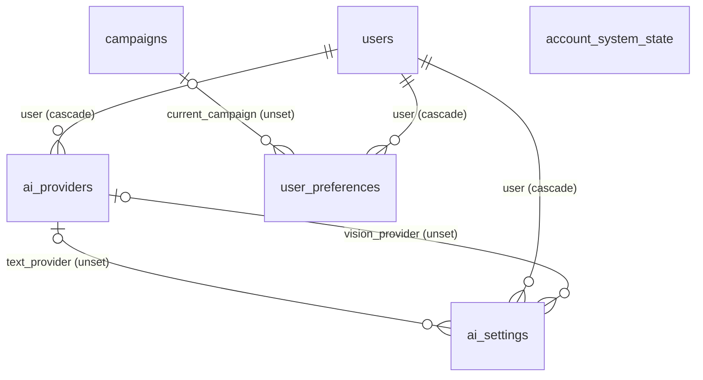
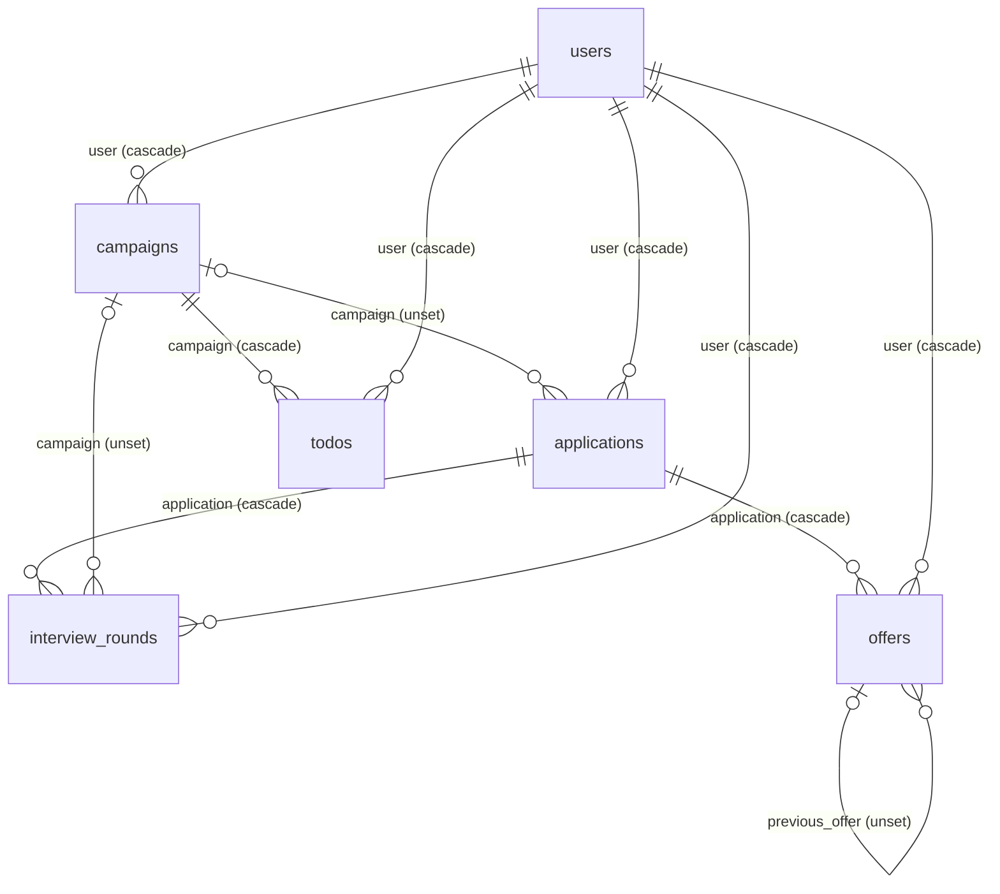
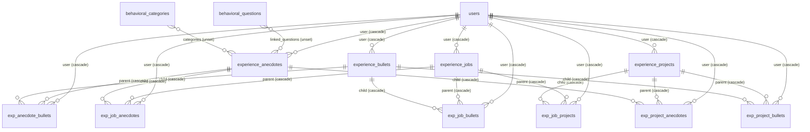
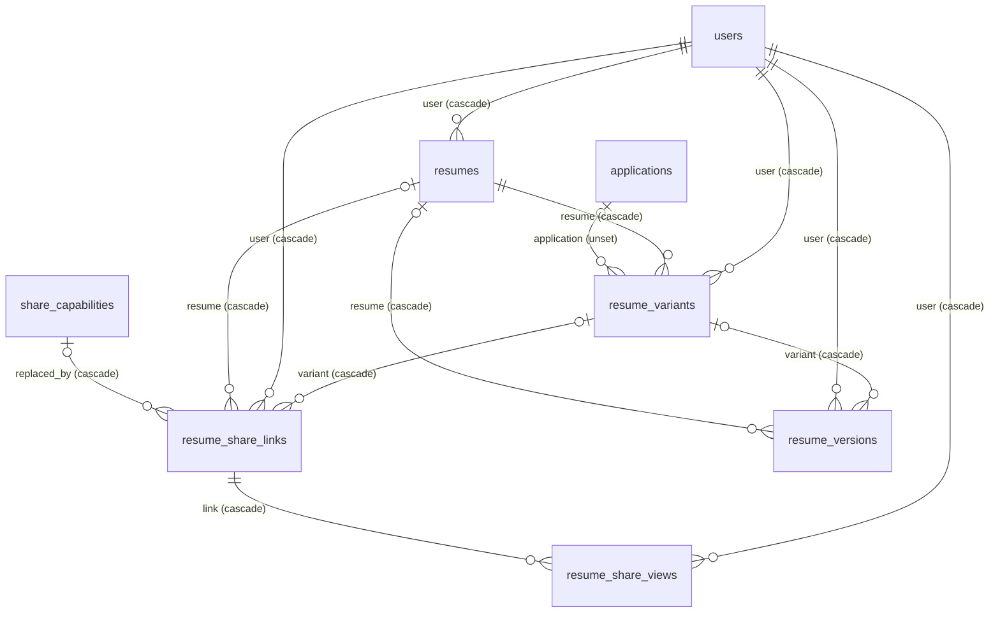
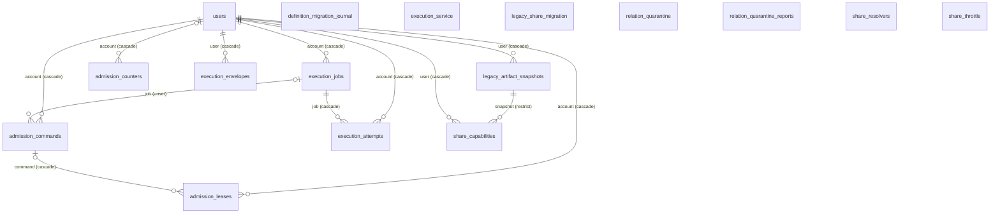
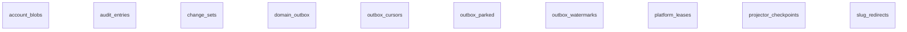
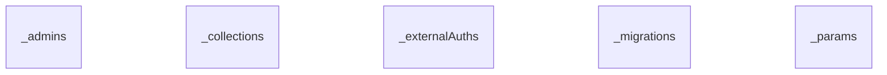

# DR-0004 ERD, generated

<!-- Generated from contracts/database/erd.json by node scripts/conformance/run.mjs --write. Edit contracts/database/erd-decisions.json for the written fields, and regenerate contracts/database/schema-snapshot.json with harness/bench/schema_dump.py for the rest. -->

Every collection at snapshot `988653c` (PocketBase 0.22.22), 55 in all, the 5 system tables, the 11 planned or held tables DR-0004 places, and 86 relations. The written fields (group, scope, rows, writers, purge, a text partition, merge, notes, and the planned tables) are DR-0004's and change only with a revision of it; the rest comes from the snapshot, and the PR that changes a migration regenerates this file. Delete behavior is PocketBase's own, measured on the snapshot's native run: multi-optional-no-cascade unset, single-optional-cascade cascade, single-optional-no-cascade unset, single-required-cascade cascade, single-required-no-cascade restrict.

| Store | Kind | Location | Canonical | Backup |
| --- | --- | --- | --- | --- |
| sqlite-data | sqlite | pb_data/data.db | yes | an online SQLite-consistent copy (decision 8) |
| files | files | pb_data/storage | yes | copied after the database copy; deletes wait for the backup (decision 8) |
| sqlite-logs | sqlite | pb_data/logs.db | no | not needed for a restore |

## Account, preferences, and AI settings

| Entity | Status | Scope | Partition | Indexed | Writers | On account delete |
| --- | --- | --- | --- | --- | --- | --- |
| ai_providers | live | account | user (relation, cascade) | 1, partition first | #73's AI hook routes, for the runner with the caller's bearer and the runner key; the owner deletes through REST under #9's rules | cascades with the account |
| ai_settings | live | account | user (relation, cascade) | 1, partition first | the runner with the caller's token through REST under #9's rules | cascades with the account |
| user_preferences | live | account | user (relation, cascade) | 1, partition first | the SPA through PocketBase's REST API under #9's rules, until its context transfers to #19's gateway | cascades with the account |
| users | live | account | id (self, pocketbase) | primary key | PocketBase's own auth routes under its rules; the signup, demo, admission, and profile file hooks guard what a client may set | PocketBase deletes the account; every relation to it cascades, unsets, or restricts as listed |
| account_system_state | planned (ROUNDS-00B-L07/S2) | account | user (relation, cascade) | 1, partition first | #177's state migration and its demo hooks | cascades with the account |

## Campaigns, applications, rounds, offers, and todos

| Entity | Status | Scope | Partition | Indexed | Writers | On account delete |
| --- | --- | --- | --- | --- | --- | --- |
| applications | live | account | user (relation, cascade) | 1, partition first | the SPA through PocketBase's REST API under #9's rules, until its context transfers to #19's gateway | cascades with the account |
| campaigns | live | account | user (relation, cascade) | 2, partition first | the SPA through PocketBase's REST API under #9's rules, until its context transfers to #19's gateway | cascades with the account |
| interview_rounds | live | account | user (relation, cascade) | 2, partition first | the SPA through PocketBase's REST API under #9's rules, until its context transfers to #19's gateway | cascades with the account |
| offers | live | account | user (relation, cascade) | 2, partition first | the SPA through PocketBase's REST API under #9's rules, until its context transfers to #19's gateway | cascades with the account |
| todos | live | account | user (relation, cascade) | 2, partition first | the SPA through PocketBase's REST API under #9's rules, until its context transfers to #19's gateway | cascades with the account |

## Experience records and their junctions

| Entity | Status | Scope | Partition | Indexed | Writers | On account delete |
| --- | --- | --- | --- | --- | --- | --- |
| exp_anecdote_bullets | live | account | user (relation, cascade) | 2, partition first | the SPA through PocketBase's REST API under #9's rules, until its context transfers to #19's gateway | cascades with the account |
| exp_job_anecdotes | live | account | user (relation, cascade) | 2, partition first | the SPA through PocketBase's REST API under #9's rules, until its context transfers to #19's gateway | cascades with the account |
| exp_job_bullets | live | account | user (relation, cascade) | 2, partition first | the SPA through PocketBase's REST API under #9's rules, until its context transfers to #19's gateway | cascades with the account |
| exp_job_projects | live | account | user (relation, cascade) | 2, partition first | the SPA through PocketBase's REST API under #9's rules, until its context transfers to #19's gateway | cascades with the account |
| exp_project_anecdotes | live | account | user (relation, cascade) | 2, partition first | the SPA through PocketBase's REST API under #9's rules, until its context transfers to #19's gateway | cascades with the account |
| exp_project_bullets | live | account | user (relation, cascade) | 2, partition first | the SPA through PocketBase's REST API under #9's rules, until its context transfers to #19's gateway | cascades with the account |
| experience_anecdotes | live | account | user (relation, cascade) | 1, partition first | the SPA through PocketBase's REST API under #9's rules, until its context transfers to #19's gateway | cascades with the account |
| experience_bullets | live | account | user (relation, cascade) | 1, partition first | the SPA through PocketBase's REST API under #9's rules, until its context transfers to #19's gateway | cascades with the account |
| experience_jobs | live | account | user (relation, cascade) | 1, partition first | the SPA through PocketBase's REST API under #9's rules, until its context transfers to #19's gateway | cascades with the account |
| experience_projects | live | account | user (relation, cascade) | 1, partition first | the SPA through PocketBase's REST API under #9's rules, until its context transfers to #19's gateway | cascades with the account |

## Resumes, versions, snapshots, and shares

| Entity | Status | Scope | Partition | Indexed | Writers | On account delete |
| --- | --- | --- | --- | --- | --- | --- |
| resume_share_links | live | account | user (relation, cascade) | 1, partition first | no client write since #14; one server write marks a link replaced | cascades with the account |
| resume_share_views | live | account | user (relation, cascade) | 1 | no client write since #14 | cascades with the account |
| resume_variants | live | account | user (relation, cascade) | 3, partition first | the SPA through PocketBase's REST API under #9's rules, until its context transfers to #19's gateway | cascades with the account |
| resume_versions | live | account | user (relation, cascade) | 3, partition first | the SPA through PocketBase's REST API under #9's rules, until its context transfers to #19's gateway | cascades with the account |
| resumes | live | account | user (relation, cascade) | 2, partition first | the SPA through PocketBase's REST API under #9's rules, until its context transfers to #19's gateway | cascades with the account |

## Practice drafts, attempts, progress, and content

```mermaid
erDiagram
  campaigns |o--o{ ai_coding_attempts : "campaign (unset)"
  execution_envelopes |o--o{ ai_coding_attempts : "envelope (unset)"
  ai_coding_rounds ||--o{ ai_coding_attempts : "round (cascade)"
  users ||--o{ ai_coding_attempts : "user (cascade)"
  campaigns |o--o{ ai_coding_drafts : "campaign (unset)"
  ai_coding_rounds ||--o{ ai_coding_drafts : "round (cascade)"
  users ||--o{ ai_coding_drafts : "user (cascade)"
  behavioral_categories }o--o{ behavioral_questions : "categories (unset)"
  campaigns ||--o{ code_drafts : "campaign (cascade)"
  users ||--o{ code_drafts : "user (cascade)"
  users ||--o{ question_timers : "user (cascade)"
  take_home_assignments ||--o{ take_home_attempts : "assignment (cascade)"
  campaigns |o--o{ take_home_attempts : "campaign (unset)"
  execution_envelopes |o--o{ take_home_attempts : "envelope (unset)"
  users ||--o{ take_home_attempts : "user (cascade)"
  take_home_assignments ||--o{ take_home_drafts : "assignment (cascade)"
  campaigns |o--o{ take_home_drafts : "campaign (unset)"
  users ||--o{ take_home_drafts : "user (cascade)"
  campaigns |o--o{ user_progress : "campaign (unset)"
  users ||--o{ user_progress : "user (cascade)"
  behavioral_guides
  coding_guides
  coding_questions
  system_design_guides
  system_design_questions
```

| Entity | Status | Scope | Partition | Indexed | Writers | On account delete |
| --- | --- | --- | --- | --- | --- | --- |
| ai_coding_attempts | live | account | user (relation, cascade) | 1, partition first | the SPA for rows that aren't graded, under #9's rules and #3's grade rules; a graded row only through the execution store's completion (#3's PR 4) | cascades with the account |
| ai_coding_drafts | live | account | user (relation, cascade) | 2, partition first | the SPA through PocketBase's REST API under #9's rules, until its context transfers to #19's gateway | cascades with the account |
| ai_coding_rounds | live | content | none | 1 | migrations at start (seed and definitions); no runtime writer | not account data |
| behavioral_categories | live | content | none | 1 | migrations at start (seed and definitions); no runtime writer | not account data |
| behavioral_guides | live | content | none | 1 | migrations at start (seed and definitions); no runtime writer | not account data |
| behavioral_questions | live | content | none | 1 | migrations at start (seed and definitions); no runtime writer | not account data |
| code_drafts | live | account | user (relation, cascade) | 1, partition first | the SPA through PocketBase's REST API under #9's rules, until its context transfers to #19's gateway | cascades with the account |
| coding_guides | live | content | none | 1 | migrations at start (seed and definitions); no runtime writer | not account data |
| coding_questions | live | content | none | 1 | migrations at start (seed and definitions); no runtime writer | not account data |
| question_timers | live | account | user (relation, cascade) | 2, partition first | the SPA through PocketBase's REST API under #9's rules, until its context transfers to #19's gateway | cascades with the account |
| system_design_guides | live | content | none | 1 | migrations at start (seed and definitions); no runtime writer | not account data |
| system_design_questions | live | content | none | 1 | migrations at start (seed and definitions); no runtime writer | not account data |
| take_home_assignments | live | content | none | 1 | migrations at start (seed and definitions); no runtime writer | not account data |
| take_home_attempts | live | account | user (relation, cascade) | 1, partition first | the SPA for rows that aren't graded, under #9's rules and #3's grade rules; a graded row only through the execution store's completion (#3's PR 4), and the runner's own writes no longer run | cascades with the account |
| take_home_drafts | live | account | user (relation, cascade) | 2, partition first | the SPA through PocketBase's REST API under #9's rules, until its context transfers to #19's gateway | cascades with the account |
| user_progress | live | account | user (relation, cascade) | 1, partition first | the SPA through PocketBase's REST API under #9's rules, until its context transfers to #19's gateway | cascades with the account |

## Admission, execution, quarantine, and share secrets

| Entity | Status | Scope | Partition | Indexed | Writers | On account delete |
| --- | --- | --- | --- | --- | --- | --- |
| admission_commands | live | account | account (relation, cascade) | 3, partition first | Caller routes and the sweep in the admission hooks (#1); #20 adds domain-command rows | cascades with the account; rows expire after 24 hours, #20's after 30 days |
| admission_counters | live | account | account (relation, cascade) | 2 | Caller routes and the sweep in the admission hooks (#1) | cascades with the account; counters expire after a day |
| admission_leases | live | account | account (relation, cascade) | 4, partition first | Caller routes and the sweep in the admission hooks (#1) | cascades with the account |
| definition_migration_journal | live | platform | none | 1 | #2's migration at start | not account data |
| execution_attempts | live | account | account (relation, cascade) | 4 | the execution store's Service routes only (#3) | cascades with the account |
| execution_envelopes | live | account | user (relation, cascade) | 3, partition first | the execution store's Service routes only (#3) | cascades with the account |
| execution_jobs | live | account | account (relation, cascade) | 3, partition first | the execution store's Caller and Service routes only (#3) | cascades with the account |
| execution_service | live | service | none | 0 | a System hook sets its one record at start (#3) | not account data |
| legacy_artifact_snapshots | live | account | user (relation, cascade) | 1, partition first | one Caller route of the snapshot store (#4) | cascades with the account |
| legacy_share_migration | live | service | none | 1 | #14's migration at start | #76 purges an account's entries with its older links |
| relation_quarantine | live | service | owner (text, purge) | 0 | #10's migration, then an operator's replay | #76 purges an account's entries by their owner |
| relation_quarantine_reports | live | service | none | 0 | #10's migration and its dry run | not account data: counts and checksums |
| share_capabilities | live | account | user (relation, cascade) | 3, partition first | the share capability and share secret hooks only (#11, #12) | cascades with the account; #11's before-delete hook removes them first, so the restricting relation never blocks the delete |
| share_resolvers | live | service | none | 0 | a System hook sets its one record at start (#12) | not account data |
| share_throttle | live | service | none | 2 | the share lookup route, as the resolver identity (#12) | not account data: keys only, and a lookup removes entries over a day old |

## Platform tables DR-0004 places

| Entity | Status | Scope | Partition | Indexed | Writers | On account delete |
| --- | --- | --- | --- | --- | --- | --- |
| account_blobs | planned (ROUNDS-10-L01) | account | account_id (text, purge) | 1, partition first | the gateway for intake (#53 first); #6's render outputs as the execution identity once containment ships | #76 removes the row, then its file once the next backup has run |
| audit_entries | planned (ROUNDS-02-L04) | account | account_id (text, purge) | 1, partition first | #21's transaction writer, inside the gateway's transaction | #76 purges in batches; no cascade, so deleting a 50,000-row account never holds the writer |
| change_sets | planned (ROUNDS-02-L04) | account | account_id (text, purge) | 2, partition first | #21's transaction writer, inside the gateway's transaction, with a per-account commit_position | #76 purges in batches; no cascade, so deleting a 50,000-row account never holds the writer |
| domain_outbox | planned (ROUNDS-02-L05) | account | account_id (text, purge) | 3, partition first | #22's library, inside the gateway's transaction; delivery never rewrites a row | #76 purges with the account's history; relayed rows compact as #22 due-work |
| outbox_cursors | planned (ROUNDS-02-L05) | platform | none | 1 | the dispatcher identity through #22's routes; one row per consumer, its cursor the last relay_seq it stepped | not account data |
| outbox_parked | planned (ROUNDS-02-L05) | account | account_id (text, purge) | 1, partition first | the dispatcher identity through #22's routes; an event that kept failing for one consumer, with its disposition | #76 purges with the account's history |
| outbox_watermarks | planned (ROUNDS-02-L05) | account | account_id (text, purge) | 1, partition first | the dispatcher identity through #22's routes; one row per consumer and aggregate, the dedupe record a redelivery is checked against | #76 purges with the account's history |
| platform_leases | planned (ROUNDS-02-L05) | platform | none | 1 | the dispatcher identity through #22's routes; one row per lease (the relay and each due-work handler) | not account data |
| projector_checkpoints | planned (ROUNDS-02-L06) | account | account_id (text, purge) | 1, partition first | #23's projectors, in the transaction that applies their events; one row per account and projector | #76 purges an account's rows; a rebuild resets a projector's rows |
| slug_redirects | planned (ROUNDS-32-L02) | account | account_id (text, purge) | 1, partition first | #156's migration framework, which owns the map | #76 purges with the account |

## PocketBase system tables

| Entity | Status | Scope | Partition | Indexed | Writers | On account delete |
| --- | --- | --- | --- | --- | --- | --- |
| _admins | live | system | none |  | PocketBase itself | not account data |
| _collections | live | system | none |  | PocketBase itself | not account data |
| _externalAuths | live | system | recordId (text, pocketbase) |  | PocketBase itself | PocketBase removes an account's OAuth2 links with the account |
| _migrations | live | system | none |  | PocketBase itself | not account data |
| _params | live | system | none |  | PocketBase itself | not account data |

## Relations

| Relation | To | Cardinality | Required | On delete | Merge | Authorized by |
| --- | --- | --- | --- | --- | --- | --- |
| admission_commands.account | users | many-to-one | yes | cascade | n/a | owner |
| admission_commands.job | execution_jobs | many-to-one | no | unset | none | server |
| admission_counters.account | users | many-to-one | no | cascade | n/a | owner |
| admission_leases.account | users | many-to-one | yes | cascade | n/a | owner |
| admission_leases.command | admission_commands | many-to-one | no | cascade | none | server |
| ai_coding_attempts.campaign | campaigns | many-to-one | no | unset | none | relation-endpoint |
| ai_coding_attempts.envelope | execution_envelopes | many-to-one | no | unset | none | server |
| ai_coding_attempts.round | ai_coding_rounds | many-to-one | yes | cascade | none | content |
| ai_coding_attempts.user | users | many-to-one | yes | cascade | n/a | owner |
| ai_coding_drafts.campaign | campaigns | many-to-one | no | unset | none | relation-endpoint |
| ai_coding_drafts.round | ai_coding_rounds | many-to-one | yes | cascade | none | content |
| ai_coding_drafts.user | users | many-to-one | yes | cascade | n/a | owner |
| ai_providers.user | users | many-to-one | yes | cascade | n/a | owner |
| ai_settings.text_provider | ai_providers | many-to-one | no | unset | none | relation-endpoint |
| ai_settings.user | users | many-to-one | yes | cascade | n/a | owner |
| ai_settings.vision_provider | ai_providers | many-to-one | no | unset | none | relation-endpoint |
| applications.campaign | campaigns | many-to-one | no | unset | none | relation-endpoint |
| applications.user | users | many-to-one | yes | cascade | n/a | owner |
| behavioral_questions.categories | behavioral_categories | many-to-many | no | unset | none | content |
| campaigns.user | users | many-to-one | yes | cascade | n/a | owner |
| code_drafts.campaign | campaigns | many-to-one | yes | cascade | none | relation-endpoint |
| code_drafts.user | users | many-to-one | yes | cascade | n/a | owner |
| execution_attempts.account | users | many-to-one | yes | cascade | n/a | owner |
| execution_attempts.job | execution_jobs | many-to-one | yes | cascade | none | server |
| execution_envelopes.user | users | many-to-one | yes | cascade | n/a | owner |
| execution_jobs.account | users | many-to-one | yes | cascade | n/a | owner |
| exp_anecdote_bullets.child | experience_bullets | many-to-one | yes | cascade | repoint | relation-endpoint |
| exp_anecdote_bullets.parent | experience_anecdotes | many-to-one | yes | cascade | repoint | relation-endpoint |
| exp_anecdote_bullets.user | users | many-to-one | yes | cascade | n/a | owner |
| exp_job_anecdotes.child | experience_anecdotes | many-to-one | yes | cascade | repoint | relation-endpoint |
| exp_job_anecdotes.parent | experience_jobs | many-to-one | yes | cascade | repoint | relation-endpoint |
| exp_job_anecdotes.user | users | many-to-one | yes | cascade | n/a | owner |
| exp_job_bullets.child | experience_bullets | many-to-one | yes | cascade | repoint | relation-endpoint |
| exp_job_bullets.parent | experience_jobs | many-to-one | yes | cascade | repoint | relation-endpoint |
| exp_job_bullets.user | users | many-to-one | yes | cascade | n/a | owner |
| exp_job_projects.child | experience_projects | many-to-one | yes | cascade | repoint | relation-endpoint |
| exp_job_projects.parent | experience_jobs | many-to-one | yes | cascade | repoint | relation-endpoint |
| exp_job_projects.user | users | many-to-one | yes | cascade | n/a | owner |
| exp_project_anecdotes.child | experience_anecdotes | many-to-one | yes | cascade | repoint | relation-endpoint |
| exp_project_anecdotes.parent | experience_projects | many-to-one | yes | cascade | repoint | relation-endpoint |
| exp_project_anecdotes.user | users | many-to-one | yes | cascade | n/a | owner |
| exp_project_bullets.child | experience_bullets | many-to-one | yes | cascade | repoint | relation-endpoint |
| exp_project_bullets.parent | experience_projects | many-to-one | yes | cascade | repoint | relation-endpoint |
| exp_project_bullets.user | users | many-to-one | yes | cascade | n/a | owner |
| experience_anecdotes.categories | behavioral_categories | many-to-many | no | unset | none | content |
| experience_anecdotes.linked_questions | behavioral_questions | many-to-many | no | unset | none | content |
| experience_anecdotes.user | users | many-to-one | yes | cascade | n/a | owner |
| experience_bullets.user | users | many-to-one | yes | cascade | n/a | owner |
| experience_jobs.user | users | many-to-one | yes | cascade | n/a | owner |
| experience_projects.user | users | many-to-one | yes | cascade | n/a | owner |
| interview_rounds.application | applications | many-to-one | yes | cascade | none | relation-endpoint |
| interview_rounds.campaign | campaigns | many-to-one | no | unset | none | relation-endpoint |
| interview_rounds.user | users | many-to-one | yes | cascade | n/a | owner |
| legacy_artifact_snapshots.user | users | many-to-one | yes | cascade | n/a | owner |
| offers.application | applications | many-to-one | yes | cascade | none | relation-endpoint |
| offers.previous_offer | offers | many-to-one | no | unset | none | relation-endpoint |
| offers.user | users | many-to-one | yes | cascade | n/a | owner |
| question_timers.user | users | many-to-one | yes | cascade | n/a | owner |
| resume_share_links.replaced_by | share_capabilities | many-to-one | no | cascade | none | relation-endpoint |
| resume_share_links.resume | resumes | many-to-one | no | cascade | none | relation-endpoint |
| resume_share_links.user | users | many-to-one | yes | cascade | n/a | owner |
| resume_share_links.variant | resume_variants | many-to-one | no | cascade | none | relation-endpoint |
| resume_share_views.link | resume_share_links | many-to-one | yes | cascade | none | relation-endpoint |
| resume_share_views.user | users | many-to-one | yes | cascade | n/a | owner |
| resume_variants.application | applications | many-to-one | no | unset | none | relation-endpoint |
| resume_variants.resume | resumes | many-to-one | yes | cascade | none | relation-endpoint |
| resume_variants.user | users | many-to-one | yes | cascade | n/a | owner |
| resume_versions.resume | resumes | many-to-one | no | cascade | none | relation-endpoint |
| resume_versions.user | users | many-to-one | yes | cascade | n/a | owner |
| resume_versions.variant | resume_variants | many-to-one | no | cascade | none | relation-endpoint |
| resumes.user | users | many-to-one | yes | cascade | n/a | owner |
| share_capabilities.snapshot | legacy_artifact_snapshots | many-to-one | yes | restrict | none | relation-endpoint |
| share_capabilities.user | users | many-to-one | yes | cascade | n/a | owner |
| take_home_attempts.assignment | take_home_assignments | many-to-one | yes | cascade | none | content |
| take_home_attempts.campaign | campaigns | many-to-one | no | unset | none | relation-endpoint |
| take_home_attempts.envelope | execution_envelopes | many-to-one | no | unset | none | server |
| take_home_attempts.user | users | many-to-one | yes | cascade | n/a | owner |
| take_home_drafts.assignment | take_home_assignments | many-to-one | yes | cascade | none | content |
| take_home_drafts.campaign | campaigns | many-to-one | no | unset | none | relation-endpoint |
| take_home_drafts.user | users | many-to-one | yes | cascade | n/a | owner |
| todos.campaign | campaigns | many-to-one | yes | cascade | none | relation-endpoint |
| todos.user | users | many-to-one | yes | cascade | n/a | owner |
| user_preferences.current_campaign | campaigns | many-to-one | no | unset | none | relation-endpoint |
| user_preferences.user | users | many-to-one | yes | cascade | n/a | owner |
| user_progress.campaign | campaigns | many-to-one | no | unset | none | relation-endpoint |
| user_progress.user | users | many-to-one | yes | cascade | n/a | owner |
